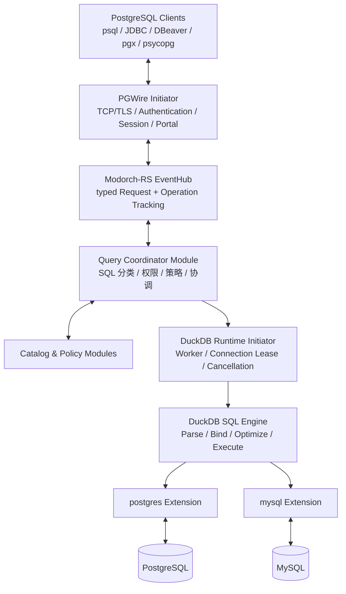
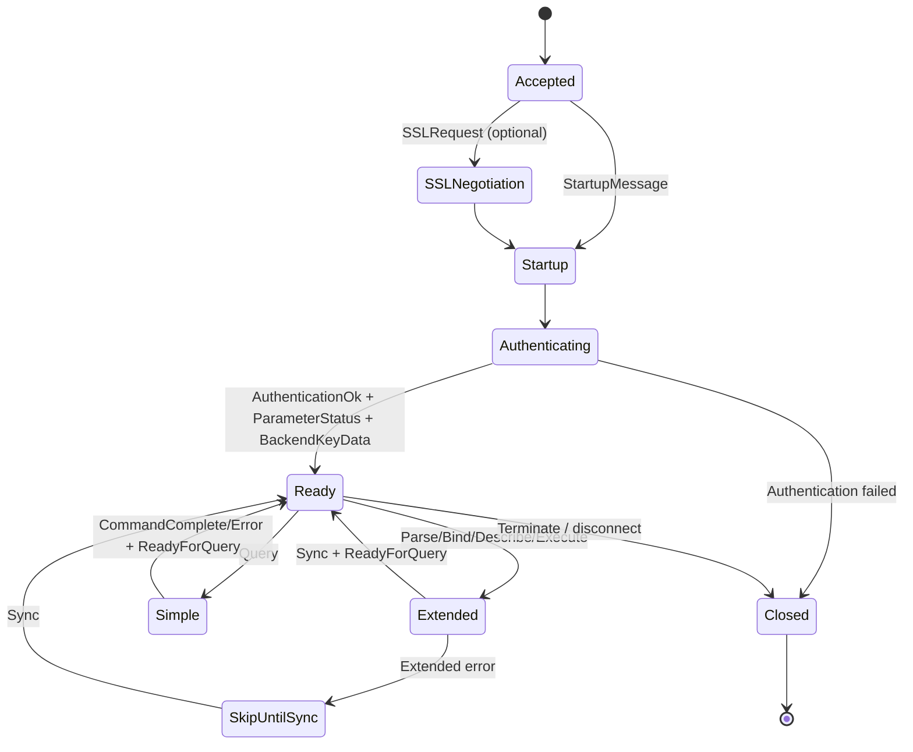
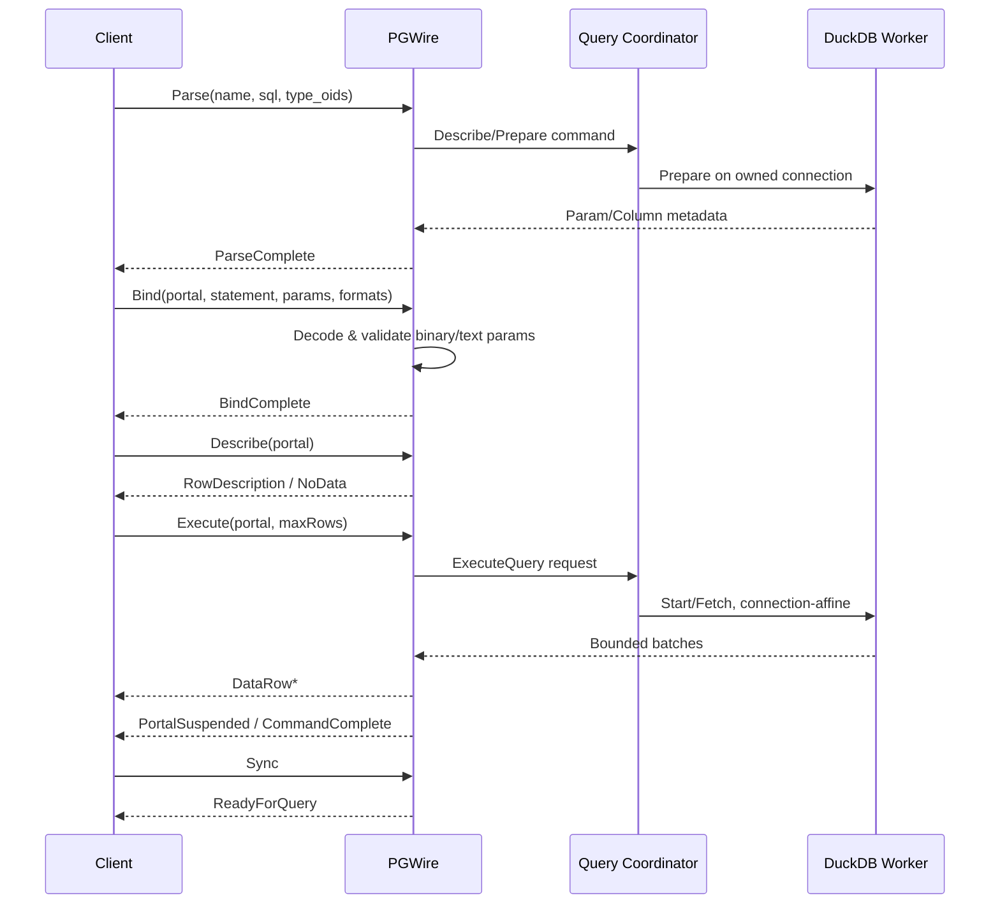
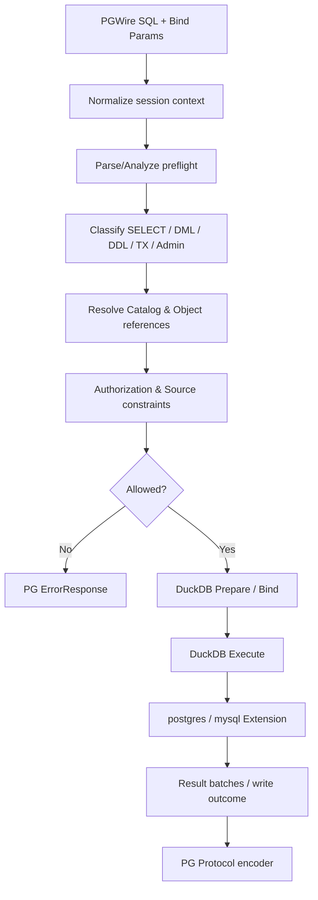
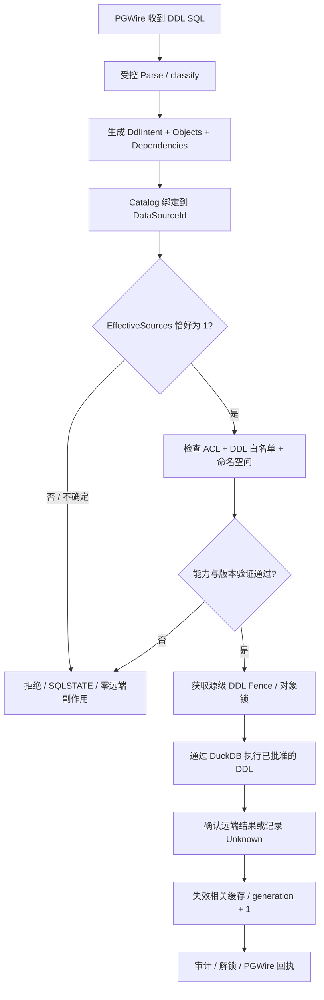
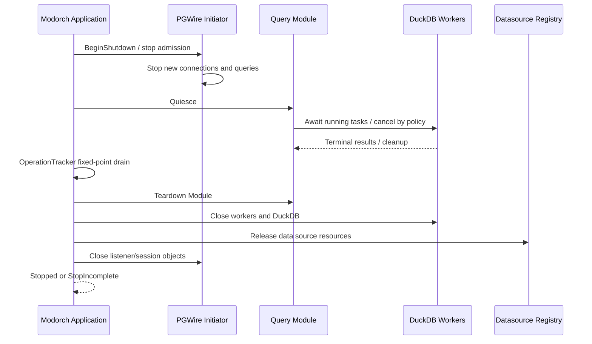

# FedEngine — 基于 Modorch-RS、PGWire 与 DuckDB 的联邦数据库引擎详细设计

> **文档版本**：v1.1（设计草案，DDL 单数据源约束修订）\
> **编写日期**：2026-11-02\
> **项目名称**：FedEngine\
> **技术栈**：Rust / Modorch-RS v0.3 / PostgreSQL Wire Protocol / DuckDB 2.0 LTS\
> **当前数据源**：PostgreSQL、MySQL\
> **状态说明**：本文件给出工程实现目标与验收契约，不宣称所列组件已全部实现或兼容性测试完成。PostgreSQL/MySQL 扩展的 Table/Schema 常用 DDL 有官方文档依据；远端 Index DDL 须按锁定版本专项验证或采用受控 DuckDB 内执行适配。

---

## 0. 执行摘要

FedEngine 是一个**支持查询、写入及受控 DDL 对象管理的联邦数据库引擎**。它在 Rust 进程中运行，对客户端提供兼容 PostgreSQL 的 Wire Protocol 入口，使用 DuckDB 作为唯一 SQL 解析、优化和执行内核，当前通过 DuckDB 的 `postgres` 和 `mysql` 扩展访问远端数据库。应用编排基于 Modorch-RS v0.3 的 Initiator、Module、ServiceRegistry、EventHub、TaskScheduler、生命周期和检查式停机模型。

**总体能力**：

1. 标准 PostgreSQL 客户端接入：`psql`、JDBC、DBeaver、`pgx`、`psycopg` 等；实现 Simple Query、Extended Query、认证、会话、参数绑定、Portal 和取消机制。
2. 统一 SQL：业务 `SELECT/INSERT/UPDATE/DELETE` 与受控 `Schema/Table/Index DDL` 均进入 DuckDB 解析及执行链路；禁止从 PGWire 直接转发任意原生 SQL 到远端。
3. 多源读取：可在一条只读 SQL 中读取 PostgreSQL、MySQL，完成跨库 JOIN、过滤、聚合和排序。
4. 远端写入：对 PostgreSQL、MySQL 已 ATTACH 的目标表支持常见 `INSERT/UPDATE/DELETE`；单条写语句只能操作一个目标数据源。
5. DDL 对象管理：支持 `Schema`、`Table`、`Index` 的创建、变更（按能力白名单）、删除和元数据管理；每条 DDL 的全部显式数据对象引用必须绑定到**同一个注册数据源**。禁止跨数据源 DDL、跨源 CTAS、跨源外键引用和任意远端 SQL 透传。
6. 有限事务承诺：当前以**单语句自动提交**为基线，不声明支持 PG 客户端显式多语句事务、分布式事务或跨库写事务。具体单语句原子性以 DuckDB 扩展和远端存储引擎支持为前提，并纳入验收测试。
7. 可用性：通过有界队列、并发与连接池限制、查询取消、结果批次背压、资源隔离和可核验的停机流程确保稳定运行。

**不可妥协的约束**：

- 对外查询协议仅为 PostgreSQL Wire Protocol；内部管理接口可以存在，但不提供第二种业务 SQL 执行入口。
- 对外展示 PostgreSQL 协议不等于完整实现 PostgreSQL 数据库系统表和所有 SQL 方言；兼容能力按清单验收。
- 只允许 `postgres`、`mysql` 两种 DuckDB 数据源扩展；其他数据库不在当前实施范围。
- 一个 DML 写入语句只能有一个被修改的数据源；首版进一步保守要求**写语句涉及的业务数据表均属于同一个数据源**，防止跨库 `INSERT ... SELECT` 和跨源更新语义歧义。
- **DDL 强约束**：`CREATE/ALTER/DROP` Schema、Table、Index 以及关联的读取、引用、依赖对象（如 CTAS、外键）在单条语句内必须属于同一个 `DataSourceId`；不能以“只修改一个源”为理由放行跨源读取。
- 不因协议层成功入队而声明 SQL 执行成功；不因请求超时而声明远端写入未发生。
- Modorch-RS v0.3 仍是目标框架设计基线；文内框架 API 均是接口契约示意，实际实现以正式 crate API 为准。

## 1. 目标、范围与非目标

### 1.1 功能目标

| 能力 | 当前目标 | 验收方式 |
|---|---|---|
| PostgreSQL 3.0 协议 | Startup、认证、Q、Parse/Bind/Describe/Execute/Close/Sync、错误恢复 | `psql` + 主流驱动端到端测试 |
| DuckDB SQL | 业务 SQL 均通过 DuckDB 的 Prepare/Execute 路径 | 执行追踪证明无直通分支 |
| PostgreSQL 数据源 | 查询、插入、更新、删除 | 远端 PG 实例内容校验 |
| MySQL 数据源 | 查询、插入、更新、删除 | 远端 MySQL 实例内容校验 |
| 跨源 JOIN | PostgreSQL ⇄ MySQL 双向只读 JOIN | 联表结果与独立基准一致 |
| 写入目标限制 | 单条 DML 单数据源修改且首版无跨源读写混合 | 不合法 SQL 执行前拒绝 |
| Schema/Table DDL | PostgreSQL/MySQL 上的创建、常用变更、删除与管理 | 源库对象验证、重连与缓存刷新 |
| Index DDL | 创建、删除、索引查询及受支持的维护动作；按版本能力探测启用 | 远端真实索引验证，未支持时拒绝而非伪成功 |
| DDL 单数据源限制 | 单条 DDL 的所有显式源引用均属于同一注册数据源 | AST/绑定结果、拒绝时零副作用 |
| 运行资源 | 并发上限、连接租借、流式背压、取消 | 压测和故障注入 |
| 生命周期 | 启动依赖 DAG、Ready 后开放 PG 入口、检查式停机 | 启停顺序和资源回收测试 |

### 1.2 非目标

- 不实现 PostgreSQL 存储引擎、WAL、复制协议、逻辑复制或完整数据库服务器管理功能。
- 不支持客户端发起的跨数据库写入、跨源 DDL、两阶段提交、XA 或分布式原子提交。
- 首版不承诺显式 `BEGIN/COMMIT/ROLLBACK` 跨多条业务 SQL 的事务能力。
- 不承诺所有 PostgreSQL 特有 SQL 表达式、运算符、函数、类型和系统 Catalog 100% 兼容。
- 不实现 Modorch-RS 框架自身的通用组件管理机制，FedEngine 只实现应用组件。

### 1.3 关键 ADR

| 编号 | 决策 |
|---|---|
| ADR-001 | 对外产品及仓库命名统一为 `FedEngine`；Cargo 包与 crate 采用 `fedengine-*` |
| ADR-002 | Modorch-RS 是唯一应用编排框架，顶层组件只分 Initiator 和 Module |
| ADR-003 | PGWire 是唯一对外 SQL 查询协议，DuckDB 是唯一业务 SQL 执行内核 |
| ADR-004 | PostgreSQL/MySQL 通过 DuckDB 官方扩展 ATTACH，不使用业务 SQL 旁路执行 |
| ADR-005 | 只读语句允许跨源，写语句只允许一个数据源，首版不允许混合跨源读写 |
| ADR-006 | 会话协议状态、DuckDB Connection、远端物理连接是三个独立生命周期 |
| ADR-007 | EventHub 承载控制命令，结果数据走有界批次通道且纳入 OperationTracker |
| ADR-008 | 默认单语句自动提交；明确拒绝不支持的显式事务，不伪造事务成功 |
| ADR-009 | 对写入取消/超时的最终结果可能未知，禁止不经确认就自动重试 |
| ADR-010 | Schema/Table/Index DDL 的 `ReadSources ∪ WriteSources ∪ DependencySources` 必须严格等于单个 `DataSourceId`；跨源引用执行前拒绝 |
| ADR-011 | 使用 DuckDB 支持的原生 DDL 路径为先，远端 Index DDL 如不可用，须经受控 DDL Adapter 在 DuckDB 执行路径内完成；不开放任意 SQL 透传 |
| ADR-012 | MySQL `SCHEMA` 对应远端数据库命名空间；创建/删除必须限定在该数据源明确授权的 namespace 白名单内 |
| ADR-013 | DDL 受对象级授权、操作范围锁、Catalog generation、缓存失效和不确定结果追踪共同约束 |

## 2. 技术基线与依赖

| 组件 | 建议版本/原则 | 备注 |
|---|---|---|
| Rust | Edition 2024；MSRV 按 Modorch 实际实现锁定 | 不在此处伪定已兼容的 MSRV |
| Modorch-RS | v0.3 **架构规范** | Initiator/Module、EventHub、生命周期等以框架实现版本为准 |
| Tokio | 1.x | 由宿主进程创建 Runtime，框架不私建全局 Runtime |
| pgwire | `0.42.1` 评估基线 | 封装为协议适配层，实际特性按编译和兼容测试锁定 |
| DuckDB 核心 | `2.0.0 LTS` 评估基线 | 正式部署须固定核心和扩展构建版本 |
| duckdb-rs | `~1.20000.1` 评估基线 | 对应 DuckDB 2.0.0 版本系列，使用 bundled 或经验证的系统库 |
| DuckDB Extensions | `postgres`、`mysql` | 两者必须匹配 DuckDB ABI、平台和发行渠道 |
| DDL 实现 | 原生 DuckDB DDL 优先；能力不足时采用受控 DuckDB 执行适配 | 禁止 PGWire → 源库的原生 SQL 旁路 |
| Tracing | `tracing` | 全局 subscriber 由应用负责 |

> 版本判定：DuckDB 2.0.0 发布于 2026-10-21；`duckdb-rs` 现采用 `1.MAJOR_MINOR_PATCH.x` 的编码方案。本方案不能仅凭版本数字保证 PGWire、DuckDB、扩展、Rust 绑定已联调通过。

### 2.1 部署依赖注意

`duckdb-rs` 的 `bundled` 仅解决核心引擎编译/链接，不代表 PostgreSQL/MySQL 扩展自动静态包含。必须有明确的**扩展安装/校验/加载策略**：联网环境从可信官方仓库安装并校验版本；离线环境随包提供经过批准的对应 `.duckdb_extension`，并在启动前验证可加载。

生产环境推荐固定 Cargo.lock、DuckDB 核心版本、扩展 SHA256、容器镜像与远端数据库最低测试版本。DuckDB 2.0 的持久化文件可能与旧版本存在兼容风险；升级先影子环境回归再切换。

## 3. 总体架构



### 3.1 分层职责

| 层 | 负责 | 不负责 |
|---|---|---|
| PGWire | PG 协议状态、身份认证、编解码、PG Session、Portal、错误同步 | 直接执行远端 SQL |
| Query Coordinator | SQL 校验、授权、语句分类、数据源约束、调度、执行回执 | 逐行网络编码、管理原生 DuckDB Connection |
| Catalog/Policy | 统一可见目录、表元数据、访问授权、能力约束 | 长时间持有查询 Worker |
| DuckDB Runtime | SQL Prepare/Execute、Worker、连接租借、结果获取、取消 | 认证 PG 客户端 |
| DuckDB Extensions | 访问 PostgreSQL/MySQL、读取与写入 | 跨源写入的全局原子提交 |
| Modorch-RS | 组件装配、生命周期、消息、任务监督、停机排空 | SQL 业务语义 |

## 4. Modorch-RS 集成设计

### 4.1 Initiator 与 Module 划分

| 组件 ID | 类型 | 拥有资源/行为 | 强依赖 |
|---|---|---|---|
| `duckdb-runtime` | Initiator | Database Instance、阻塞 Worker 池、ExecutionPort、扩展加载 | 无 |
| `datasource-registry` | Initiator | 数据源配置快照、Secret Resolver、目录 generation | 配置服务 |
| `pgwire-listener` | Initiator | TCP Listener、TLS、连接任务、PG Session Registry | query 模块 Ready、认证服务 |
| `query-coordinator` | Module | QueryRequest Handler、调度策略、在途任务状态 | duckdb-runtime、datasource-registry、catalog、policy |
| `catalog-manager` | Module | 元数据刷新、名称映射、缓存失效控制 | datasource-registry、duckdb-runtime |
| `policy-manager` | Module | SQL 授权判定、表/列策略与审计事件 | datasource-registry |

`pgwire-listener` 的主要作用是以 Registry 暴露受控 Listener/Session 管理资源；它也可注册可选 EventEndpoint。`query-coordinator` 的业务操作通过 EventHub 进行，请勿直接暴露 Module 私有实例。向其他模块提供的 DuckDB 接口必须是窄 `ExecutionPort`，不能泄漏裸 `Connection`。

### 4.2 应用编排与 DAG

建议启动拓扑：

```text
Shared Config / Secrets
  ├── datasource-registry
  └── duckdb-runtime
         └── catalog-manager
                ├── policy-manager
                └── query-coordinator
                        └── pgwire-listener (Ready 后激活外部准入)
```

以上逻辑依赖不意味着 Initiator 可以依赖 Module。Modorch-RS v0.3 默认**禁止 Initiator → Module 的强依赖**。因此 PG Listener 只能依赖已注册的受控 `QueryIngressPort` 或在 Application 激活阶段等待 Query Coordinator Ready：

1. 先建立 Listener 资源，但**关闭外部请求准入**。
2. 按 Initiator 阶段执行资源 Setup/Start。
3. Module 注册 Handler，完成 Catalog/Policy/Query Ready。
4. Application 显式 `activate_ingress` 后才可对外接受 Startup/SQL。
5. 停机时优先撤销外部准入，最后释放依赖资源。

**避免将 Query Module 放入 Initiator 的 `requires` 中**；Readiness barrier 是 Application 的启动门槛，不是跨层 DAG 反向依赖。

### 4.3 EventHub 使用边界

业务约定：

```text
Topic: query/execute/v1
Request: ExecuteQuery { session, sql, parameters, limits, operation_id }
Response: AcceptedExecution { handle_id, columns, result_stream, completion }
```

- `EventHub.request()` 只返回控制面受理与启动结果，不承诺请求返回时 SQL 已完成。
- SQL 结果行通过有界 `mpsc` Channel 传输 **RecordBatch/RowChunk**，不以 EventHub Event 逐行广播。
- 从 SQL 入场、发送控制请求、派生 Worker、读取结果、PG 编码直到客户端收到终止报文，始终持有合法 Operation Lease/TaskGroup 所有权。
- `Accepted`、`Started`、`Completed`、`CommitConfirmed`、`Indeterminate` 状态分别记录，不能混用。
- 取消不等于回滚；已入队操作不能因调用者超时被当作“从未执行”。

## 5. PGWire Server 设计

### 5.1 协议阶段与范围



P0 必须实现：SSLRequest/Startup、认证握手、ParameterStatus、BackendKeyData、ReadyForQuery、Simple Query、Parse/Bind/Describe/Execute/Close/Sync、RowDescription、DataRow、CommandComplete、ErrorResponse、CancelRequest。P1 扩展 COPY、更多系统 Catalog、协议 3.2 功能。

### 5.2 简单查询协议

- `Query` 报文可能包含多个 SQL 语句；必须用真正 SQL 解析器分割，**禁止按分号字符串直接拆分**。
- 每个子语句独立校验和执行；首版建议保守地拒绝一个 Simple Query 消息中包含**多条写语句**或事务控制指令，避免跨语句原子性歧义。
- SELECT：RowDescription → DataRow* → CommandComplete → ReadyForQuery。
- INSERT/UPDATE/DELETE：无返回行时直接 CommandComplete；有 DuckDB `RETURNING` 能力且兼容时输出列描述与行结果（逐项验收）。
- Empty Query：EmptyQueryResponse → ReadyForQuery。
- 出错：ErrorResponse → ReadyForQuery，确保不会产生误导性的成功终结报文。

### 5.3 扩展查询协议



实现规范：

1. **PreparedStatement**：按 Session 隔离命名空间；区分命名/未命名 Statement；同名替换时释放旧对象。
2. **Portal**：存储已绑定的参数、编码格式和执行游标；支持命名/未命名 Portal；保留暂停后的游标位置。
3. **Bind**：实现 NULL、文本和二进制参数格式，并正确处理参数类型 OID、未知类型推断及结果格式协商。
4. **Describe**：返回 ParameterDescription、RowDescription 或 NoData；类型 OID 与列数应稳定。
5. **Execute(maxRows)**：达到行数上限后发送 PortalSuspended，下一次 Execute 从同一游标继续；只有真正完成时才发 CommandComplete。
6. **Sync**：扩展协议错误后的恢复点；出现 ErrorResponse 后丢弃到 Sync，再 ReadyForQuery。
7. **Close**：释放 Statement/Portal，不能释放仍被其它活动执行引用的物理资源。

如当前 Rust DuckDB Binding 无法满足真实的可暂停游标，必须通过 DuckDB 的 C API / Arrow 批次迭代能力封装；不得假装完整 `PortalSuspended` 功能。第一期只有在实现增量游标后才将其标为通过。

### 5.4 Session 模型

```rust
// 目标领域类型示意；并非已存在的框架 API
pub struct PgSessionState {
    pub session_id: u64,
    pub principal_id: String,
    pub database: String,
    pub application_name: Option<String>,
    pub settings: SessionSettings,
    pub tx_status: PgTransactionStatus, // I / T / E
    pub statements: StatementStore,
    pub portals: PortalStore,
    pub active_execution: Option<ExecutionId>,
}
```

PG Session 与 DuckDB Connection 不一对一；同一 Session 的连续请求可以租借不同 Worker，**但处于执行中的 Portal 必须绑定原 Worker/Connection**。连接级变量、临时对象和 Prepare 的状态不能假定自动跨 Connection 迁移。

### 5.5 兼容层

`pg-compat` 负责以下协议兼容而非执行业务 SQL：

- PostgreSQL 类型 OID ↔ DuckDB LogicalType；NULL、整数、浮点、DECIMAL、TEXT、BYTEA、BOOLEAN、DATE/TIME/TIMESTAMP、UUID、JSON 等。
- `ParameterStatus`：server_version、client_encoding、DateStyle、TimeZone 等必须和实际支持行为匹配。
- 客户端常用系统查询：`version()`、`current_database()`、`current_schema()`、`pg_catalog` 基础表/函数，通过允许的兼容对象/视图处理，并明确模拟范围。
- ErrorResponse：使用 SQLSTATE 映射；未支持功能 `0A000`、权限 `42501`、语法 `42601`、不存在对象 `42P01` 等。
- RowDescription 的 table OID、attribute number、type OID、type size、modifier 等不能简单填入错误值诱导驱动误判；无来源信息时使用 PostgreSQL 协议允许的未知字段语义。

## 6. DuckDB Runtime 设计

### 6.1 Database Instance + Worker 资源模型

```text
DuckdbRuntime (Initiator)
├── DatabaseInstance / Catalog generation
├── ExtensionManager
│   ├── postgres
│   └── mysql
├── AttachmentManager
├── BlockingWorkerPool
│   ├── Worker 0 -> DuckDB Connection 0
│   ├── Worker 1 -> DuckDB Connection 1
│   └── Worker N -> DuckDB Connection N
├── ExecutionRegistry
├── CancellationRegistry
├── QueryResourceLimiter
└── ExecutionPort (published through ServiceRegistry)
```

Rust DuckDB `Connection` 可跨线程移动，但**不是可并发共享的 Sync 对象**。推荐 Worker 线程独占连接，由 Tokio 通过受控队列提交任务；不在 Tokio 调度核心线程直接运行阻塞查询。使用 `Connection::try_clone()` 或对同一 DatabaseInstance 打开新 Connection 的具体实现须验证实例共享与 ATTACH 可见性；不可仅靠相同 `:memory:` 文本假设多个连接自动共享数据库实例。

### 6.2 Worker 租借原则

- Session 不常驻占有 DuckDB Connection。
- 短查询租借一个 Worker，执行完成、结果流排空并清理后归还。
- 活动 Portal 保持 Worker 亲和；未完成的流必须持有租约，直到完成、显式 Close 或确认取消完成。
- WorkerPool 有固定上限和排队超时；繁忙时返回明确的背压/资源不足错误。
- DuckDB 原生内部执行线程 `threads` 与并行 Query 数需要共同预算，避免 CPU 和内存超额订阅。
- 连接重用时必须重置会话设置、临时对象以及错误状态；若无法证明安全，就丢弃并重建 Worker Connection。

### 6.3 数据流

```text
SQL Query -> DuckDB Worker -> RecordBatch/RowChunk
                                  |
                                  v
                          bounded Channel
                                  |
                                  v
                           PG Row Encoder
                                  |
                                  v
                             TCP Socket
```

建议初始参数：批次 256～4096 行、Channel 容量 4～16 批次（仅作为调优起点，不是已验证的固定性能参数）。当 Channel 满时 Worker 不再无限读取；对网络慢客户端要有输出超时和最大在途缓存限制。

对于写操作，先等待执行完成/远端确认，再生成 `CommandComplete`；不要只因数据送入 Worker 队列就返回成功。受影响行数以 DuckDB 真实可提供的数据为准，不伪造；PG 客户端 `INSERT 0 n` / `UPDATE n` / `DELETE n` 的 tag 需要兼容性测试。

### 6.4 取消语义

采用 `CancelRequest -> ExecutionRegistry -> Worker interrupt handle -> terminal completion` 的链路。

- 取消令牌和 DuckDB interrupt 只表示提出请求，不保证立即停止或回滚已提交远端副作用。
- 对 SELECT，取消后停止返回新批次，并等待 Worker 完成清理。
- 对 INSERT/UPDATE/DELETE，若中途取消、网络断开或返回超时，状态可能为 **Indeterminate**，除非已拿到明确的提交或回滚结果。
- 不自动重试结果未知的写入；审计 OperationId、语句指纹、目标数据源和最终已知状态。

## 7. PostgreSQL / MySQL 数据源管理

### 7.1 数据源模型

```rust
pub enum DataSourceKind { Postgres, MySql }

pub struct DataSourceDefinition {
    pub id: String,
    pub kind: DataSourceKind,
    pub catalog_alias: String,
    pub endpoint: String,
    pub database: String,
    pub secret_ref: String,
    pub read_only: bool,
    pub ddl_enabled: bool,
    // MySQL 的 Schema 在远端与 Database 对应；仅可在授权命名空间内建删。
    pub allowed_schemas: Vec<String>,
    pub enabled: bool,
    pub generation: u64,
}
```

名称规则：`catalog_alias` 在应用中唯一、固定，不允许普通 SQL 客户端自选新的 ATTACH 名称。密码/密钥以 SecretRef 解析，不在普通日志或元数据库中保存明文。配置切换通过 generation 检测，在无活跃操作租借旧 generation 后再回收旧附件。

### 7.2 ATTACH 示例

```sql
-- 仅展示 DuckDB 内部管理员执行路径；连接凭据应从 Secret Manager 注入。
INSTALL postgres;
LOAD postgres;
INSTALL mysql;
LOAD mysql;

-- 仅展示语法，连接参数为示例占位符。
ATTACH 'host=pg.example.internal dbname=crm user=app' AS pg_crm (TYPE postgres);
ATTACH 'host=mysql.example.internal database=erp user=app' AS mysql_erp (TYPE mysql);
```

实际初始化要优先使用 DuckDB Secrets，避免异常文本中意外包含密码。`ATTACH` 由管理模块控制执行，业务 PG Session 禁止任意 ATTACH/DETACH、INSTALL/LOAD 或直接读取引擎管理配置。

### 7.3 扩展连接池

DuckDB Connection Pool 与 `postgres` / `mysql` 扩展的远端物理连接池彼此独立。必须同时设置预算：

| 控制项 | PostgreSQL | MySQL |
|---|---|---|
| 上限 | `pg_pool_max_connections` | `mysql_pool_size` |
| 池获取行为 | `pg_pool_acquire_mode='wait'` | `mysql_pool_acquire_mode='wait'` |
| 获取等待 | `pg_pool_wait_timeout_millis` | `mysql_pool_wait_timeout_millis` |
| 空闲回收 | `pg_pool_idle_timeout_millis` | `mysql_pool_connection_idle_timeout_millis` |
| 线程本地缓存 | 默认关闭，审慎启用 | 默认关闭，审慎启用 |

`pg_connection_limit` 与 `pg_connection_cache` 在 DuckDB 2.0 文档中已标记旧式配置；新设计采用 `pg_pool_*`。特别要将扩展默认 `force` 获取模式改为适合生产容量控制的 `wait`，否则达到软上限时可能继续创建连接。并行 Scan 可能临时超出部分连接池指标，仍需端到端压测观察真实峰值。

### 7.4 目录缓存与刷新

- 数据源注册后导入表/Schema/列元数据，形成 Catalog Generation。
- 外部 DDL 可能使 DuckDB 扩展元数据缓存失效；对 MySQL 可在允许的控制操作中调用 `mysql_clear_cache()`，并对 PostgreSQL 制定对应的重新解析/刷新策略。
- 元数据缓存必须有 TTL、显式 invalidation 与 schema version；Prepared Statement 应记录 Catalog Generation，不可在结构变更后盲目复用。
- 目录刷新与写 SQL、Portal 执行需协调版本屏障，防止正在执行时 `DETACH`。
- DDL 成功后必须使目标数据源的 Table/Schema/Index 元数据、Prepared Statement、Portal 新建绑定、查询计划缓存失效；索引信息不以 `duckdb_indexes()` 一项为唯一可信来源，必须结合远端索引元数据。

### 7.5 DDL 对象模型与来源映射

DDL 操作对象使用 `ObjectRef { data_source_id, catalog_alias, schema_name, object_name, kind }` 表示，其中 `data_source_id` 为唯一、不可由 SQL 客户端自行伪造的注册标识。`catalog_alias` 是对外引用名，必须稳定映射到 `DataSourceId`。

| 逻辑层 | PostgreSQL | MySQL | 约束 |
|---|---|---|---|
| DataSource | 一个预注册 PostgreSQL ATTACH 目标 | 一个预注册 MySQL ATTACH 目标 | 一条 DDL 仅使用一个 DataSourceId |
| Schema | PostgreSQL Schema（如 `public`） | 通常对应 MySQL Database / Schema 命名空间 | 不得跨其他注册源的命名空间 |
| Table | 目标 Schema 内表 | 目标 Database 内表 | 创建、变更、删除受源级与对象级权限控制 |
| Index | PostgreSQL 索引属于 Schema，绑定 Table | MySQL 索引通常以 Table 为作用域 | 必须先解析被索引 Table 的源归属，DROP INDEX 亦然 |

**MySQL 注意事项**：`CREATE SCHEMA` 与 `CREATE DATABASE` 在 MySQL 语义上密切相关。FedEngine 不能因为两个 Database 位于同一 MySQL 实例，就自动将它们视为同一个可操作数据源。若 DataSourceDefinition 只授权单个 MySQL Database，默认不能创建或删除另一个 Database；只有显式配置和授权的 namespace 才能由相同 DataSourceId 管理。即便目标物理主机相同，引用另一已注册 DataSourceId 也属于跨源，必须拒绝。

对象名统一采用受控的 `catalog.schema.object` 解析；两段名或无前缀名仅在绑定出的唯一默认源可证实时接受。任何未能唯一解析的数据源引用拒绝执行，不能回退到 DuckDB `memory.main` 或意外默认 Catalog。

DDL 对象类型至少定义 `Schema`、`Table`、`Index`。索引元数据应包含 `table_ref`、`index_name`、`unique`、`columns/expressions`、`remote_kind`、`capabilities`；对于不可反向解析或暂不支持的远端特殊索引类型，只可列出元数据，管理动作需单独鉴权与能力探测。

## 8. 统一 SQL 处理链路



### 8.1 核心原则

- SQL 预检解析可以使用受控的分析器，但**实际业务 SQL 必须通过 DuckDB Prepare/Execute**；禁止执行器不支持时静默降级为直连源库原生 SQL。
- 不允许简单通过 `sql.starts_with("SELECT")` 判定只读；必须覆盖 CTE、子查询、`RETURNING`、多语句、`CALL`、`COPY`、带副作用函数和事务控制。
- 首版开放白名单 SQL 分类：普通 SELECT、可验证的单目标 INSERT/UPDATE/DELETE、经过单源验证的 `CREATE/ALTER/DROP` Schema/Table/Index；不在白名单中的语法 Fail Closed。
- 如果预检分析器无法准确识别表来源、被修改对象或副作用，拒绝而不是猜测。

### 8.2 读写范围矩阵

| SQL 场景 | 首版行为 | 原因 |
|---|---|---|
| PG 单库 SELECT | 允许 | 常规读取 |
| MySQL 单库 SELECT | 允许 | 常规读取 |
| PG 与 MySQL 跨库 SELECT/JOIN | 允许 | 联邦读取核心能力 |
| PG 单库 INSERT/UPDATE/DELETE | 允许 | DuckDB postgres 扩展支持 |
| MySQL 单库 INSERT/UPDATE/DELETE | 允许 | DuckDB mysql 扩展支持 |
| PG → MySQL 或 MySQL → PG 写入 | 拒绝 | 首版写语句只可访问一个目标源 |
| 同一 SQL 写入 PG、MySQL 两端 | 拒绝 | 不支持跨源原子提交 |
| Schema/Table/Index DDL | 单 DataSourceId + 对象权限 + 能力白名单；允许的操作经 DuckDB 执行 | MySQL DDL 不可笼统承诺事务原子性，Index 需专项适配与验证 |
| 显式 BEGIN/COMMIT/ROLLBACK | 首版拒绝或以严格兼容规则处理无活动事务 | 不模拟不存在的多语句事务 |
| 任意 `postgres_execute` / `mysql_execute` 直通 | 业务入口拒绝 | 违反统一 SQL 语义约束 |
| 业务 SQL 直接 ATTACH/DETACH/LOAD/INSTALL | 拒绝 | 保护数据源边界与凭据 |

**说明**：此处的“写入限制”是 FedEngine 的产品策略，比 DuckDB 自身“同一事务只写一个 attached database”的限制更严格，可在未来明确评估后调整，但本版不放开。

### 8.3 示例 SQL

> 以下对象名需根据真实 ATTACH Catalog/Schema 映射调整；例子展示语义，而不是声称所有 Schema 层级已在所有版本验证。

```sql
-- PostgreSQL 数据源读写
SELECT * FROM pg_crm.public.customer WHERE id = 1;
INSERT INTO pg_crm.public.customer(id, name) VALUES (1001, 'Alice');
UPDATE pg_crm.public.customer SET name = 'Alice A' WHERE id = 1001;
DELETE FROM pg_crm.public.customer WHERE id = 1001;

-- MySQL 数据源读写
SELECT * FROM mysql_erp.orders WHERE id = 2001;
INSERT INTO mysql_erp.orders(id, amount) VALUES (2001, 99.00);
UPDATE mysql_erp.orders SET amount = 109.00 WHERE id = 2001;
DELETE FROM mysql_erp.orders WHERE id = 2001;

-- 只读跨库 JOIN
SELECT c.id, c.name, o.id AS order_id, o.amount
FROM pg_crm.public.customer AS c
JOIN mysql_erp.orders AS o ON o.customer_id = c.id
WHERE o.amount > 100;
```

### 8.4 无主键或唯一键时的 UPDATE/DELETE

**不能假定所有源表都有主键**。设计策略：

1. 不以“无主键”作为所有读写的统一禁止条件；SELECT/INSERT 正常允许。
2. UPDATE/DELETE 默认使用 DuckDB 官方扩展原生支持的路径，不自行执行“先 SELECT 再逐行写”作为通用实现。
3. 对需按行定位但没有稳定 Row Identity 的执行路径，必须在执行前拒绝，或要求数据源显式声明并验证稳定唯一键。不得通过非唯一列随意构造逐行更新。
4. `UPDATE t SET ... WHERE ...` 和 `DELETE FROM t WHERE ...` 即使无主键，也应在对应驱动真实测试通过后支持正常的集合语义；不能把“更新多行”误解为非法。
5. 对远端 UPDATE/DELETE 的受影响行数、NULL 条件、触发器、外键与并发修改行为逐一纳入验收。


### 8.5 正式 DDL 功能范围（v1.1）

FedEngine 的 DDL 不再属于模糊的“按需管理”附属能力，而是当前正式目标。对象范围只包含 **Schema、Table、Index**，不扩张为任意 PostgreSQL/MySQL 管理指令。`CREATE/ALTER/DROP` 的精确语法以 DuckDB 和扩展验证结果及本节白名单为准。

| 目标对象 | CREATE | ALTER / 管理 | DROP | 元数据 | 首版保证方式 |
|---|---|---|---|---|---|
| Schema（PG） | 目标 | 重命名待专项验证 | 目标 | 列表、存在性、归属、权限 | 官方扩展已列出 CREATE/DROP；逐语句验收 |
| Schema（MySQL） | 条件目标 | 默认不开放跨 namespace 迁移 | 条件目标 | 已授权 Database/Schema 列表 | 官方扩展列出 CREATE/DROP；须 namespace 授权 |
| Table（PG） | 目标 | 常用 ADD/DROP/RENAME/TYPE 需逐项验证 | 目标 | 列、类型、约束、所属 Schema | 官方扩展已列出 CREATE/ALTER/DROP |
| Table（MySQL） | 目标 | 常用 ADD/DROP/RENAME/TYPE 需逐项验证 | 目标 | 列、类型、约束、所属 Database | 官方扩展已列出 CREATE/ALTER/DROP |
| Index（PG） | 正式目标，待专项验证/实现 | 重命名/重建按能力开放 | 正式目标，待专项验证/实现 | 名称、表、列、唯一性、状态 | 不将 DuckDB 本地 INDEX 支持当成远端 INDEX 已支持 |
| Index（MySQL） | 正式目标，待专项验证/实现 | 重命名/重建按能力开放 | 正式目标，待专项验证/实现 | 名称、表、列、唯一性、状态 | 需按表定位，不能照搬 PG 索引命名空间 |

标记为“目标”的意思是产品必须完成实现及端到端验收，**不表示当前发布包已经验证该能力**。`ALTER` 只开放经过验收的细分动作，不开放任意原生 DDL 变种。建议第一批索引范围为普通 B-tree 单列/联合索引及唯一索引，其他方法（例如表达式索引、部分索引、全文或特定引擎类型）以能力矩阵另行开放。

### 8.6 单数据源不变量（强制）

针对每条 DDL，建立如下集合：

- `TargetSources`：待创建、修改、删除的目标对象所在数据源；包含索引所属表。
- `ReadSources`：CTAS、默认表达式、子查询、辅助表达式中被引用的业务数据源。
- `DependencySources`：外键、索引关联表、Schema 迁移源/目的地以及其他可解析的对象依赖。
- `EffectiveSources = TargetSources ∪ ReadSources ∪ DependencySources`。

**准入条件：`|EffectiveSources| = 1`，并且所有对象均解析至同一个已启用、具备 DDL 权限的 DataSourceId。** 若集合为空、大小不为 1、存在未知引用或源归属不确定，都拒绝。唯一源不等于可跳过 ACL；无权限仍拒绝。

此外：

1. 同一物理 PostgreSQL/MySQL 实例注册为两个 DataSourceId，也不能在一条 DDL 中混用两个别名。
2. `CREATE TABLE ... AS SELECT ...` 即使只写一个源，也不得读取另一源；如果仅引用同源，则在该变种通过扩展验收后允许。
3. `ALTER TABLE ... SET SCHEMA ...` 的原 Schema 和目标 Schema 必须归属同一 DataSourceId；跨源对象迁移禁止。
4. `FOREIGN KEY REFERENCES` 以及依赖类型、函数、表达式等只允许同源且能解析的受支持对象；远端隐含副作用（Trigger/Procedure 等）无法单靠 SQL AST 证明，须由远端专用权限约束。
5. `DROP SCHEMA ... CASCADE`、批量执行的多条 DDL、`CREATE DATABASE`、直接指定其他源的 DDL 通道首版默认拒绝；以后启用也必须重新制定依赖和副作用边界。
6. SQL 客户端不能直接调用 `postgres_execute()`、`mysql_execute()`、`CONNECT`、`ATTACH`、`DETACH` 等突破验证范围的功能。
7. 不按 SQL 首关键字、字符串包含关系来证明“单数据源”；必须 AST + Binder/Catalog 归属解析，语法无法判定即拒绝。

这里的“单数据源”约束作用于**每条独立 DDL**。一次 PGWire Simple Query 如果携带多条语句，首版含 DDL 的消息必须拆分校验并禁止跨语句隐式批处理，最保守实现直接拒绝多语句 DDL 消息。

### 8.7 SQL 访问矩阵示例

以下 SQL 是面向 FedEngine 的目标语法示意，具体 Index 能否以原生 DuckDB DDL 在附加库执行，需通过实际版本测试确认；不代表 PostgreSQL/MySQL 扩展已全面支持所有示例。

```sql
-- 合法：仅操作 pg_crm 数据源
CREATE SCHEMA pg_crm.sales;
CREATE TABLE pg_crm.sales.orders (id BIGINT, amount DECIMAL(18,2));
ALTER TABLE pg_crm.sales.orders ADD COLUMN note VARCHAR;
CREATE INDEX orders_amount_idx ON pg_crm.sales.orders (amount);
DROP INDEX orders_amount_idx; -- 执行前必须解析唯一的源归属与被索引 Table

-- 合法：仅操作 mysql_erp 数据源
CREATE TABLE mysql_erp.main.orders_archive (id BIGINT, amount DECIMAL(18,2));
CREATE INDEX orders_amount_idx ON mysql_erp.main.orders_archive (amount);

-- 必须拒绝：目标在 PG，数据读取来自 MySQL
CREATE TABLE pg_crm.sales.copied AS
SELECT * FROM mysql_erp.main.orders;

-- 必须拒绝：任何跨源依赖
CREATE TABLE pg_crm.sales.audit (
    id BIGINT,
    -- 外键表如由另一个 DataSourceId 注册，必须拒绝
    customer_id BIGINT REFERENCES other_source.main.customer(id)
);
```

**MySQL Schema 操作示例**（仅在 `allowed_schemas` 与数据库权限授权后生效）：

```sql
CREATE SCHEMA mysql_erp.sandbox;
DROP SCHEMA mysql_erp.sandbox;
```

这类操作可能创建/删除远端 MySQL Database，不能因为它使用 `mysql_erp` 前缀就无条件放行。`DROP INDEX` 不显式包含 Table 时，必须从可靠的源索引元数据中唯一定位；不能假设 PostgreSQL 与 MySQL 的作用域相同。

### 8.8 DDL 准入与执行流程



执行顺序必须为 **解析 → 完整绑定 → 单源校验 → 权限校验 → 能力检查 → 锁定 → 执行 → 确认 → 缓存刷新 → 回执**。所有可能发生远端副作用的操作必须处于锁定和审计范围内。对象源校验失败时尚未取得可执行 DDL 权限，也不允许发生任何远端 DDL。

`DdlIntent` 建议包含：

```rust
pub enum DdlObjectKind { Schema, Table, Index }
pub enum DdlAction { Create, Alter, Drop, Inspect }

pub struct ObjectRef {
    pub data_source_id: String,
    pub catalog_alias: String,
    pub schema_name: String,
    pub object_name: String,
    pub kind: DdlObjectKind,
}

pub struct DdlIntent {
    pub action: DdlAction,
    pub primary_object: ObjectRef,
    pub target_sources: Vec<String>,
    pub read_sources: Vec<String>,
    pub dependency_sources: Vec<String>,
    pub expected_catalog_generation: u64,
    pub requested_by: String,
    pub dry_run: bool,
}
```

该结构是逻辑契约；实现应使用强类型的 `DataSourceId`、去重集合和已解析不可变 AST 引用，而不是信任字符串。`Inspect` 是独立元数据读取操作，不等于允许客户端自行发起任意原生系统查询。

### 8.9 DuckDB 原生 DDL 与远端 Index 管理差异

官方 `postgres` / `mysql` 扩展文档明确列出 `CREATE TABLE`、`ALTER TABLE`、`DROP TABLE`、`CREATE SCHEMA`、`DROP SCHEMA`。DuckDB 本身支持 `CREATE INDEX` 和 `DROP INDEX`，但这些事实**不能证明远端 ATTACH Catalog 上所有 Index DDL 都已实现且映射正确**。尤其 MySQL 索引的命名与 `DROP INDEX` 语义不能直接按 PostgreSQL 推断。

按照以下优先级落地：

**路径 A：原生扩展 DDL。** 对于经版本锁定与实际测试通过的 DDL，直接由 DuckDB Prepared/Execute 执行。所有客户端 SQL 必须预先通过权限和单源校验。

**路径 B：受控 DDL Adapter（能力缺口补齐）。** 若 Index 创建/删除不能由 DuckDB 原生 ATTACH DDL 正确完成，则由 FedEngine 对有限的 `DdlIntent` 做强类型、白名单转换，在 DuckDB 执行的内部操作中调用适配层，最终由目标扩展执行远端 DDL。可评估 DuckDB 自定义 Extension/函数或严格限制的官方 `postgres_execute` / `mysql_execute`，但只能由内部生成已验证的 DDL 模板，**不能把客户端原始 SQL 字符串透传、不能绕过 DuckDB 执行入口**。若连此路径也无法满足“业务 SQL 由 DuckDB 解析并执行”的严格契约，则须扩展 DuckDB Catalog/Extension DDL 支持，而不是偷偷增加直连 SQL 第二通道。

**路径 C：显式拒绝。** 对不在已验收白名单内的索引方法、约束表达式、异构 ALTER 选项等，返回 `FeatureNotSupported`，不假装成功。索引管理整体仍属于正式研发与验收目标，不能因为暂未实现就把需求从文档删除。

安全边界：不开放来自 PGWire 用户的任意 `CALL postgres_execute('alias', sql)` / `CALL mysql_execute(...)`。内部生成的 DDL 必须进行标识符逐段引用转义、参数化或严格 AST 构造，并使用最小权限数据源凭据。任何试图串联多语句、访问不在 `DdlIntent` 内的对象或注入其他 SQL 语法的行为应拒绝。

### 8.10 Index 元数据与 DROP 归属解析

PostgreSQL Index 与 MySQL Index 的归属模型不同：

- PostgreSQL：索引属于某个 Schema，与目标 Table 存在依赖；`DROP INDEX` 通常不带表名，必须依 `schema + index_name` 定位原表及 DataSourceId。
- MySQL：索引依附于 Table，常见删除语法需要表名；FedEngine 的统一 SQL 输入若缺少表标识，必须可靠地从 `(source, schema, index)` 找到唯一表，否则拒绝并要求明确目标。
- `duckdb_indexes()` 主要描述 DuckDB 自身目录中的二级索引；不能在未经验证时认为它穷尽了远端 PostgreSQL/MySQL 的全部索引，必须通过数据源内部元数据适配发现。
- 唯一索引、主键约束、外键依赖应区别建模；不能对一个名字进行 `DROP INDEX` 就假设不会改变约束语义。

元数据来源可采用扩展可见的系统视图/安全的受控元数据查询：PG 的 `pg_catalog.pg_index` / `pg_class` / `pg_namespace`、MySQL 的 `information_schema.statistics` / `information_schema.tables`。这些是用于**系统元数据发现的内部固定模板**，不得变成开放任意 SQL 的业务旁路。

### 8.11 DDL 锁、并发、Portal 和代际

- 锁粒度先按 `DataSourceId` 实施 `DdlFence`（读写锁或准入门），后续可细化为 `(source, schema, object)`，但锁顺序固定防止死锁。
- 同源结构变更需阻止新旧执行计划交叉使用旧 Catalog；在途已绑定/运行 Portal 与 DDL 的优先级需定义，首版采用“等待相关 Portal 结束或按策略取消后再 DDL”。
- 不能持有 DuckDB Connection Lock 同步等待 EventHub Serial Lane，避免状态机重入死锁。
- DDL 前冻结目标源代际，成功后 `CatalogGeneration += 1`，对目标源的 Prepared Statement、对象缓存、计划缓存失效或强制重新 Bind。
- 索引变更可以不改变表列结构，但仍须刷新索引元数据、统计信息及依赖的计划缓存。
- DDL 长时间执行时也必须在 Modorch `TaskGroup` 和 `OperationTracker` 内计数；Shutdown 不得在 DDL 未结束时释放 DuckDB/远端连接资源。

### 8.12 DDL 事务、失败与回执

对 PostgreSQL 可在目标扩展和远端事务能力范围内争取单语句 DDL 原子性，但不能无测试直接承诺所有 DDL rollback。MySQL 官方文档明确说明其 DDL 不属于可通过常规事务回滚的操作；因此**不把 DML 的单语句原子性承诺套用到 MySQL DDL**。

| 状况 | 服务端行为 |
|---|---|
| 单源校验失败 | 执行前返回 SQLSTATE，源库零副作用 |
| DDL 不支持或权限不足 | 执行前拒绝，不发送到远端 |
| 远端确定成功 | 更新 CatalogGeneration；必要时刷新元数据；返回对应 CommandComplete |
| 远端确定失败 | 返回真实错误；必要时查询远端是否存在部分副作用 |
| 执行超时或连接中断，结果未知 | `OutcomeUnknown` / 审计 OperationId；不得自动重试破坏性 DDL |
| 已确认远端成功但 Catalog 刷新失败 | 保留真实成功事实，标记 `MetadataStale`，告警并阻止依赖旧元数据的新 DDL |

PGWire 原生错误响应不能完整表示所有内部状态；内部审计记录应包括 `DdlExecutionId`、对象与源、已确认副作用、元数据刷新状态。客户端在不确定结果后重新尝试，应先通过对象状态核对，而不是服务端隐式重试。`IF EXISTS/IF NOT EXISTS` 也不能代替对幂等与并发竞态的专门验证。

### 8.13 DDL 访问控制

权限采用 `Principal × DataSourceId × Schema × Object × Action` 分级；缺省拒绝，源级 `ddl_enabled=false` 或数据源 `read_only=true` 一律拒绝任何改变源状态的 DDL。

| 操作 | 至少需要的权限 | 额外条件 |
|---|---|---|
| `CREATE SCHEMA` | `CREATE_SCHEMA` on Source | namespace allowlist |
| `DROP SCHEMA` | `DROP_SCHEMA` on Schema + Source | 默认禁止 CASCADE / 系统 Schema |
| `CREATE TABLE` | `CREATE_TABLE` on Schema | 目标 Schema 存在或已授权创建 |
| `ALTER TABLE` | `ALTER_TABLE` on Table | 字段/约束能力白名单 |
| `DROP TABLE` | `DROP_TABLE` on Table | 依赖验证、默认禁止 CASCADE |
| `CREATE INDEX` | `CREATE_INDEX` on Table | Index 类型、列及表达式白名单 |
| `DROP INDEX` | `DROP_INDEX` on Table + Index | 真实表归属可解析且非保护索引 |
| `INSPECT` | `VIEW_METADATA` on Source/Schema | 仅返回可见的对象元数据 |

ACL 校验不代替远端数据库权限：DuckDB Extensions 连接使用的远端账号也必须限制对未经授权对象的操作。高风险 Schema 删除建议额外审计，并在业务配置中明确 `allow_drop_schema`，不默认开启。

### 8.14 DDL 与 Modorch-RS 组件映射

DDL 不新增第三种顶层组件：

- `module-query`：解析 DDL / 生成 `DdlIntent`、委派授权与协调。
- `module-policy`：校验单源作用域、对象权限、目标范围和数据源可写性。
- `module-catalog`：解析对象归属、维护 Schema/Table/Index 元数据、刷新代际与订阅变更。
- `initiator-duckdb`：管理 DDL Worker、Connection Lease、DuckDB 内部执行适配和完成信号。
- `initiator-datasource`：提供 DataSourceId、namespace 配置、扩展 capabilities。
- `initiator-pgwire`：负责 SQL 与 PGWire 消息，不负责自己执行 DDL 或与远端数据库直接通信。

DDL 控制消息使用 EventHub typed Request；大元数据查询使用按限流分页的查询结果，不能在 EventHub 广播携带大量远端对象定义。

### 8.15 DDL 能力探测与门槛

启动时依据 `DuckDB核心版本 × 扩展版本 × 源库版本 × 操作种类` 加载能力矩阵；关键功能必须在一次性测试数据库中做端到端验证后方可在生产配置启用，不要在启动过程中对用户业务库做破坏性试探。

验收至少包括：PG 与 MySQL 两端 CREATE/ALTER/DROP TABLE、CREATE/DROP SCHEMA、CREATE/DROP INDEX，索引唯一性、源对象实际存在、跨源 CTAS 拒绝、索引 DROP 归属解析、缓存代际更新、断线或超时后真实状态核对。

“产品支持”意味着对应能力已实现且经上述完整测试，而不只是 DuckDB CLI 能解析语法。

## 9. 显式事务与单语句原子性

### 9.1 基线语义

- PostgreSQL 协议提供的 `ReadyForQuery` 状态字段**不等于**必须承诺完整 PostgreSQL 多语句事务。
- 默认每个允许的业务 DML 作为一个独立语句执行；执行完成后向客户端报告结果。
- 写入操作的事务边界尽量依赖 DuckDB 扩展及远端原生存储引擎的单语句事务；针对 MySQL 还需确认表使用具备事务能力的存储引擎。
- 任何写入执行期间发生的异常，都应区分 `RolledBack`、`Committed`、`CommitUnknown`，不要简单标记失败即保证未写入。
- 如果某驱动/表无法保证该语句所要求的原子性，明确拒绝该类写操作或降低为已披露的能力等级；不得隐瞒风险。
- MySQL DDL 不是常规可回滚事务操作，不能把 DML 的单语句原子性承诺推广到 DDL；DDL 成功、失败与结果未知必须分开记录。

### 9.2 PG 事务命令策略

首版建议客户端 `BEGIN` 返回 SQLSTATE `0A000`，不进入 T 状态；若已发生语义不一致，终止执行并返回协议错误。对 `COMMIT`/`ROLLBACK` 在无活动事务时采用 PostgreSQL 兼容行为需要单独测试，但不能将拒绝的 `BEGIN` 后续写入包装成有效事务。

JDBC 等客户端可能自动发送 `BEGIN`，故应分别验证 autocommit=true 和显式事务关闭场景。若业务必须支持多条 SQL 的显式事务，应作为独立里程碑增加 **Session-pinned 单数据源事务**，而非在首版假装支持。

## 10. 跨源查询一致性与优化

- 跨库 JOIN 由 DuckDB 完成；过滤、投影及必要情况下部分计算由扩展下推至源库。
- PostgreSQL 和 MySQL 的独立源库不能保证共享一个全局时间点的一致性快照；文档明确为**跨源非全局快照一致性**。
- 优先通过源端谓词下推缩小拉取数据量；避免 JOIN 前把大表全部拉入内存。
- 必须控制 DuckDB `memory_limit`、临时目录、线程数、每源远端连接池与整体并发。
- 重要查询记录规划信息、源扫描行数、耗时和推下去的过滤条件；对带敏感常量的计划做脱敏。
- DuckDB 2.0 的 `CONNECT` 远端路由能力不作为首版通用执行模式；优先 ATTACH 来保持可控的联邦语义。

## 11. 核心领域接口（Rust 契约草案）

以下为应用层接口示例，便于工作项分解；未宣称与现有 Modorch 目标 Trait 完全同名或可直接编译。

```rust
pub type ExecutionId = u128;

#[derive(Clone)]
pub struct ExecutionContext {
    pub execution_id: ExecutionId,
    pub session_id: u64,
    pub principal_id: String,
    pub deadline: std::time::Instant,
    pub catalog_generation: u64,
    pub max_rows: Option<u64>,
}

pub enum StatementKind {
    Query,
    Insert,
    Update,
    Delete,
    Ddl, // Schema/Table/Index：进入强制单 DataSourceId 约束验证
}

pub enum ExecutionState {
    Admitted,
    Running,
    Streaming,
    Completed,
    CancelRequested,
    Cancelled,
    CommitUnknown,
    Failed,
}

pub struct ColumnMeta {
    pub name: String,
    pub pg_type_oid: u32,
    pub duckdb_type_name: String,
    pub nullable: Option<bool>,
}

pub enum ResultChunk {
    Rows { row_count: usize, encoded_batch: Vec<u8> },
    CommandComplete { tag: String, affected_rows: Option<u64> },
    ExecutionError { sqlstate: String, message: String },
}

// PGWire 和 DuckDB Runtime 之间的受控服务端口。
#[async_trait::async_trait]
pub trait ExecutionPort: Send + Sync {
    async fn prepare(&self, ctx: ExecutionContext, sql: String)
        -> Result<PreparedDescriptor, EngineError>;
    async fn execute(&self, req: ExecuteRequest)
        -> Result<ExecutionHandle, EngineError>;
    async fn fetch(&self, handle_id: ExecutionId, max_rows: u32)
        -> Result<FetchResult, EngineError>;
    async fn cancel(&self, handle_id: ExecutionId)
        -> Result<CancelReceipt, EngineError>;
    async fn close(&self, handle_id: ExecutionId)
        -> Result<(), EngineError>;
    // DDL 命令同样经 DuckDB 执行：由源作用域门禁放行后才可调用
    async fn execute_ddl(&self, ctx: ExecutionContext, intent: VerifiedDdlIntent)
        -> Result<DdlExecutionReceipt, EngineError>;
}
```

真实实现须对 `ResultChunk` 的 `Vec<u8>` 编码归属作明确选择：建议传递 Arrow RecordBatch 或自定义中性 ColumnarBatch，再由 PGWire 根据前端要求编码；以上示例只说明流式背压契约，**不代表强制在 DuckDB 侧进行 PostgreSQL 报文编码**。

### 11.1 ExecutionHandle 生命周期

```text
Created -> Admitted -> Running -> Streaming -> Completed
                 |          |          |
                 +----------+----------+-> CancelRequested
                                           |
                                           +-> Cancelled / Failed / Completed / CommitUnknown
```

Query Coordinator 不允许永久同步等待自己的 Serial Lane 内的 Worker 完成；长执行交给 TaskScheduler 管理，初始响应返回受控句柄，完成状态另行确认。Handle Close 与进程 Drain 要等待真正终结，不能仅删除 HashMap 条目。

### 11.2 数据源服务接口

```rust
#[async_trait::async_trait]
pub trait DataSourceRegistryPort: Send + Sync {
    async fn resolve(&self, alias: &str) -> Result<DataSourceDefinition, EngineError>;
    async fn snapshot(&self) -> Result<CatalogSnapshot, EngineError>;
    async fn refresh(&self, alias: &str) -> Result<CatalogGeneration, EngineError>;
    // DDL 对象归属解析：包括通过索引名称反向解析所属 Table
    async fn resolve_ddl_scope(&self, intent: &DdlIntent) -> Result<DdlScope, EngineError>;
    // 返回经验证的 Schema/Table/Index 能力矩阵
    async fn ddl_capabilities(&self, alias: &str) -> Result<DdlCapabilities, EngineError>;
}
```

管理操作应通过显式受权入口触发，业务 PG SQL 不允许直接创建或替换 DataSourceDefinition。

## 12. Cargo Workspace 设计

```text
fedengine/
├── Cargo.toml
├── Cargo.lock
├── README.md
├── src/
│   └── main.rs                      # 进程入口：配置/信号/调度
├── crates/
│   ├── fedengine-app/               # Modorch Application Builder 和装配
│   ├── fedengine-contract/          # 请求、结果、Topic、OperationId
│   ├── fedengine-core/              # 配置、错误、基础类型、能力矩阵
│   ├── fedengine-pgwire/            # PG 协议 Initiator、Session/Portal
│   ├── fedengine-duckdb/            # DuckDB Runtime Initiator / Worker
│   ├── fedengine-datasource/        # PostgreSQL/MySQL 注册表 Initiator
│   ├── fedengine-query/             # Query Coordinator Module
│   ├── fedengine-catalog/           # Catalog Manager Module
│   ├── fedengine-policy/            # Policy Manager Module
│   ├── fedengine-ddl/               # 受控 DDL AST/Scope/Capabilities/Index Adapter（普通 Library）
│   └── fedengine-pg-compat/         # PG 类型、Catalog、SQLSTATE 映射库
├── config/
│   ├── application.toml
│   └── datasources.toml
├── tests/
│   ├── protocol/
│   ├── crud/
│   ├── federation/
│   ├── ddl/                         # 同源/跨源矩阵、Index 所属、故障与代际
│   ├── resilience/
│   └── lifecycle/
├── docker/
│   ├── docker-compose.test.yml
│   └── Dockerfile
└── docs/
    ├── architecture.md
    ├── sql-capability.md
    ├── ddl-capability-matrix.md
    ├── protocol-compatibility.md
    ├── development.md
    └── adr/
```

依赖方向：`contract/core` 仅含领域类型，不依赖 Modorch Runtime；PGWire 适配依赖 `contract` 与 Modorch Facade；Query 依赖 `contract` 和 Port 接口；DuckDB 实现负责 `ExecutionPort`；App 负责注入资源及组装。禁止让 `fedengine-duckdb` 反向依赖 PGWire 类型，以确保可独立测试。

### 12.1 Cargo.toml 基线

```toml
[package]
name = "fedengine"
version = "0.1.0"
edition = "2024"

[workspace]
resolver = "3"
members = ["crates/*"]

[workspace.package]
edition = "2024"

[workspace.dependencies]
tokio = { version = "1", features = ["rt-multi-thread", "macros", "net", "sync", "signal", "time"] }
async-trait = "0.1"
futures = "0.3"
bytes = "1"
tracing = "0.1"
thiserror = "2"
pgwire = "=0.42.1"
duckdb = { version = "~1.20000.1", features = ["bundled"] }

# Modorch 依赖按真实仓库/版本或本地 workspace 路径指定；
# v0.3 为设计基线，不能在没有正式仓库时虚构发布地址。
```

## 13. 配置与部署

### 13.1 配置结构

```toml
[application]
name = "fedengine"

[pgwire]
listen = "0.0.0.0:15432"
max_connections = 256
startup_timeout_ms = 10000
query_timeout_ms = 60000
tls_required = true

[duckdb]
database_path = "./data/fedengine.duckdb"
max_workers = 8
threads = 4
memory_limit = "4GB"
temp_directory = "./data/tmp"
result_channel_batches = 8

[postgres_extension]
enabled = true
pool_acquire_mode = "wait"
pool_max_connections = 16
pool_wait_timeout_ms = 30000

[mysql_extension]
enabled = true
pool_acquire_mode = "wait"
pool_size = 16
pool_wait_timeout_ms = 30000

[query]
allow_cross_source_read = true
allow_cross_source_write = false
allow_cross_source_ddl = false
allow_multi_statement_write = false
explicit_transaction = false
require_single_source_for_write_statement = true

[ddl]
enabled = true
objects = ["schema", "table", "index"]
require_single_source_for_all_references = true
reject_multi_statement_ddl = true
allow_arbitrary_remote_execute = false
require_verified_capabilities = true
allow_drop_schema = false
allow_drop_cascade = false
source_lock_timeout_ms = 30000
metadata_refresh_on_success = true

[ddl.index]
allow_create = true
allow_drop = true
# 仅通过锁定版本集成测试的 Index 类型和变种
allowed_kinds = ["btree"]
allow_unique = true

[shutdown]
grace_period_secs = 30
```

该 TOML 是 **FedEngine 业务配置 Schema 草案**，`max_workers`、`result_channel_batches` 等不是 DuckDB 原生参数。实现时由应用配置转换器映射成正确的 DuckDB SET/ATTACH/TaskScheduler 参数并验证上限。

数据源配置包含 Endpoint、数据库名、Alias、SecretRef、读写标志、DDL 开关、授权 Schema 命名空间和连接池配置；**不存明文密码**。MySQL 新建/删除 Schema 时必须具备明确的 `allowed_schemas` 白名单。

### 13.2 启动时序

1. 读取与校验配置；检查 Modorch Factory/Component ID/依赖图。
2. 初始化 secrets、数据源定义快照；验证正式环境的 TLS 配置。
3. 初始化 DuckDB、检查核心版本/扩展 ABI、加载 postgres/mysql。
4. 设置内存/线程/连接池限制，创建 ATTACH Catalog 并校验只读/读写权限。
5. 创建 Worker Pool；完成 PostgreSQL/MySQL 数据源可用性探针。
6. 安装 Catalog/Policy/Query Handler、受控 DDL 解析/单源门禁和 Index 能力矩阵；生产环境只加载预先验证的能力记录，不在业务库试执行破坏性 DDL。
7. PG Listener 激活连接准入，报告 `Ready`。

关键组件出错时，执行带日志的启动失败回滚；不能留下端口已开放但 Query Module 不可用的半启动状态。

### 13.3 停机时序



`StopIncomplete` 时保留仍被依赖的资源和运行条件，允许检查式重试；单独的强制停机可以中止进程，但不能把结果记录成优雅停机成功。

## 14. 安全设计

- PGWire 认证优先 SCRAM-SHA-256 + TLS；不在生产默认采用 Trust 或明文认证。
- 身份映射：PG 用户 → FedEngine Principal → 允许的 Catalog/Schema/Table/Operation。
- SQL 注入防护以标准 Bind 参数为主；内部生成的 `ATTACH`/对象名须使用安全标识符引用，不能直接拼接用户可控文本。
- 禁止从业务 SQL 触发文件读写、任意扩展加载、任意 DuckDB Secret 管理、远端执行辅助函数及不受控管理函数。
- 防止 DuckDB 共享 Instance 下 Catalog、Secret、Session 变量产生跨租户可见性。首版定义一个明确的可信应用安全域；如需强租户隔离，使用独立引擎实例/进程及独立 Secret Store，不依赖 PG Session 的逻辑隔离即可保证多租户安全。
- SQL 和错误日志脱敏（密码、凭据、Token、敏感字段），审计保留 Statement Fingerprint、用户、源库、操作、状态和耗时。

## 15. 可靠性与可观测性

### 15.1 核心指标

- `pgwire_connections_active`、`pgwire_startup_failures_total`、`pgwire_extended_errors_total`
- `query_inflight`、`query_queued`、`query_latency_ms`、`query_cancel_total`
- `query_write_committed_total`、`query_write_unknown_total`、`query_write_rejected_total`
- `duckdb_workers_busy`、`duckdb_connection_lease_ms`、`duckdb_memory_bytes`
- `postgres_pool_active`、`mysql_pool_active`、`remote_pool_wait_ms`
- `ddl_inflight`、`ddl_rejected_cross_source_total`、`ddl_permission_denied_total`
- `ddl_index_capability_rejected_total`、`ddl_outcome_unknown_total`、`ddl_metadata_stale_total`
- `query_result_channel_queued_batches`、`query_result_bytes_total`
- `application_shutdown_incomplete_total`、`component_health_status`

注意高基数：不把原始 SQL/SessionID/用户 ID 等直接作为 Prometheus 标签。

### 15.2 故障场景

| 场景 | 处理规则 |
|---|---|
| PostgreSQL/MySQL 不可用 | 已有查询失败，受影响源进入 Degraded；无跨源静默替代 |
| 连接池耗尽 | 有界等待→明确资源不足/超时；不无限创建远端连接 |
| 慢客户端 | 结果背压；超限取消/断开并确认 Worker 回收 |
| DuckDB OOM/系统内存压力 | admission 限流、memory_limit、temp spill；进程级 OOM 不能保证清理 |
| 表 Schema 改动 | Generation 失效、重新 Describe/Prepare、必要时返回可重试错误 |
| PG 连接断开且写入进行中 | 尝试协作取消，最终可能 `CommitUnknown`；不自动重放 |
| Worker panic | 标记 Worker 不健康，销毁相关连接，Supervisor 报告并补偿 |
| 停机超时 | StopIncomplete，不能提前销毁依赖资源 |

## 16. 性能策略

- 分层限流：PG Session 数、活动 SQL 数、DuckDB Worker 数、单源远端连接数、结果批次数独立设限。
- 读多写少负载优先控制 Scan 并行；写操作避免因 Worker 池膨胀导致数据库锁争用。
- 优先使用 DuckDB 扩展谓词下推、列裁剪；验证 JOIN 计划避免无谓全量传输。
- 短 SQL Prepare Cache 按 Session/SQL 指纹/参数类型/Catalog Generation 缓存；设置 LRU 上限，避免无限增长。
- 强调两类吞吐指标：已提交 DML TPS 与已完成 Query QPS；不以请求入队 TPS 代替执行完成 TPS。
- 记录 P50/P95/P99 延迟与最坏内存占用，避免仅关注平均 TPS。

## 17. 测试矩阵与验收门槛

### 17.1 协议测试

| 测试 | 验收结果 |
|---|---|
| `psql` Startup + SCRAM + TLS | 可连接；错误认证拒绝 |
| Simple Query 多种 SELECT | 结果和 PG 行描述正确 |
| JDBC Prepared Statement | Parse/Bind/Describe/Execute 正确 |
| Binary/Text Params + NULL | 数值、文本、时间等格式正确 |
| Portal `maxRows` | 真正暂停/恢复，无重复/遗漏 |
| Extended Error + Sync | 可恢复到 ReadyForQuery |
| CancelRequest | 取消后状态可观测、资源最终释放 |
| 重连/断线 | 不保留悬空 Session/Portal |

### 17.2 CRUD 与联邦测试

| 用例 | 验收 |
|---|---|
| PostgreSQL CRUD | 远端表数据正确，受影响行数准确 |
| MySQL CRUD | 远端表数据正确，受影响行数准确 |
| PostgreSQL × MySQL JOIN | 结果与独立测试预期一致 |
| 跨数据源写入 | 执行前拒绝且无远端副作用 |
| 缺少主键表 UPDATE/DELETE | 官方扩展路径测试；不安全能力拒绝 |
| 多行写入中异常 | 验证远端支持的单语句原子性，不虚假宣称 rollback |
| 写入时断网/Cancel | `Committed/RolledBack/Unknown` 状态真实报告 |
| 远端 Schema 更新 | 缓存失效与重新准备正确 |
| PostgreSQL Schema/Table DDL | CREATE、常用 ALTER、DROP 及元数据与代际更新经过远端验证 |
| MySQL Schema/Table DDL | 授权 namespace 内成功；非法 Database/Schema 被拒绝 |
| PostgreSQL/MySQL Index DDL | CREATE/DROP/元数据列出，索引类型与唯一性验证，未通过不放行 |
| DDL 单数据源限制 | 两源混合的 CTAS/依赖/批量 DDL 在远端副作用发生前拒绝 |
| DDL 索引归属 | DROP INDEX 解析到准确 Table + Source，重名或未知直接拒绝 |
| DDL 并发 / 超时 | 锁和 Portal 代际正确，结果未知可追踪，不盲目重试 |
| 只读源上的写入 | 明确权限错误，不做任何写入 |

### 17.3 并发/稳定性测试

- 16/64/256 客户端混合读写测试，观察 PG Session 数、DuckDB Worker 饱和和远端连接峰值。
- 同时跨库 JOIN + PG 写入 + MySQL 写入验证资源公平性。
- 远端连接池等待、超时、断开、重建及元数据刷新竞态。
- Client Disconnect → Cancel → Worker Complete → OperationTracker Drain 全链路无资源泄漏。
- 快速停机、长查询停机、启动失败回滚和 ForceShutdown 区分语义。

### 17.4 工程验收命令

```bash
cargo fmt --all -- --check
cargo check --workspace --all-targets
cargo test --workspace
cargo clippy --workspace --all-targets -- -D warnings
```

这些是验收计划，**不是本设计文档生成时已执行的命令**。

### 17.5 DDL 单数据源验收清单

- [ ] 单条 DDL 只有一个 `DataSourceId`；目标、读取、依赖对象均属于该源。
- [ ] 不完整、重名或有歧义的 Index 归属在执行前拒绝。
- [ ] PG 与 MySQL 对 Schema/Table 的 CREATE/ALTER/DROP 行为逐项有版本测试记录。
- [ ] PG 与 MySQL 的 INDEX 创建/删除是远端真实对象修改，而非仅创建 DuckDB 本地索引。
- [ ] 不能使用任意 SQL 执行函数绕过 DDL 白名单。
- [ ] DDL ACL、namespace、read_only、CASCADE 管控正确。
- [ ] DDL 成功后 CatalogGeneration、缓存、Prepared Statement 处理一致。
- [ ] DDL 中断、失败、超时与 MetadataStale 均可观测。

## 18. 分阶段实施计划

| 阶段 | 主要交付物 | 退出条件 |
|---|---|---|
| M0 架构与基建 | Workspace、Modorch 集成、配置/错误/Contract、CI | 应用组件按需注册、Ready/Stop 可运行 |
| M1 PGWire | Startup、认证、Simple/Extended、Session/Portal | psql/JDBC 端到端协议测试 |
| M2 DuckDB Runtime | Engine Init、扩展加载、Worker、Connection Lease、结果流 | 读写 SQL 可执行、资源无悬挂 |
| M3 双数据源 CRUD | postgres/mysql Attach、读写授权、DML 约束 | 两个源库 CRUD 全部通过 |
| M4 联邦查询 | 跨库只读 JOIN、Catalog、谓词下推、缓存刷新 | 复杂 SELECT 与规模化数据正确性通过 |
| M5 DDL 对象管理 | 单源强约束、Schema/Table DDL、Index 适配、ACL、对象锁、元数据刷新 | PG/MySQL Schema/Table/Index 全部按能力矩阵及零跨源副作用验收 |
| M6 生产化 | 取消、内存/并发限制、TLS、安全、指标、优雅停机 | 故障注入、负载测试与检查式停机通过 |

**阶段划分不把 CRUD 当作未来才会出现的新能力，而是把已经确定的读写技术能力纳入 FedEngine 的核心验收范围**；在项目实现进展未核验前，不能将阶段交付说成已经完成。

## 19. 风险及收口建议

| 风险 | 等级 | 收口策略 |
|---|---|---|
| DuckDB SQL 与 PostgreSQL 客户端 SQL 方言差异 | 高 | 协议兼容层、严格支持矩阵、驱动回归 |
| Prepared Statement/Portal 与 DuckDB Connection 亲和性 | 高 | Worker-affine Portal、真实增量 fetch |
| 写入失败后结果不确定 | 高 | OperationID + CommitUnknown + 不自动重试 |
| 跨库写入被误放行 | 高 | SQL 预检 Fail Closed、数据源集合校验 |
| 跨源 DDL 或 CTAS 被误放行 | 极高 | 有效来源集合严格单 DataSourceId，依赖解析失败拒绝 |
| 远端 Index DDL 被误认为受支持 | 高 | 按核心/扩展/源版本专项验证，必要时构建受控 DuckDB 执行适配 |
| MySQL Schema 与 Database 语义混淆 | 高 | 授权 namespace 列表和 DataSourceId 边界同时控制 |
| DDL 结果不确定或缓存不一致 | 高 | OperationId、Catalog generation、DdlFence、失败后元数据复核 |
| MySQL 表存储引擎或 DDL 原子性不足 | 高 | DML/DDL 分级承诺与真实故障测试 |
| 双层连接池耗尽 | 高 | wait 模式、预算、峰值压测 |
| DuckDB 扩展与核心 ABI 不一致 | 中高 | 版本固定、启动校验、离线依赖打包 |
| Modorch-RS v0.3 接口仍为设计草案 | 高 | 先锁定可编译的框架公共 API，再适配 |
| PG Catalog/驱动兼容面过大 | 中高 | 逐客户端功能清单和测试驱动迭代 |

## 20. 最终设计结论

FedEngine 是通过 PostgreSQL Wire Protocol 对外提供标准数据库连接体验的 **Rust 联邦数据库引擎**，而不是仅具备 SELECT 的查询代理。其技术架构固定为：

**Modorch-RS（应用架构与生命周期） → PGWire（对外 PG 协议） → Query Coordinator（SQL 治理和控制） → DuckDB（统一 SQL 执行内核） → postgres/mysql 扩展（远端实际读写）。**

在当前版本，**跨库读取、单库写入和单数据源 Schema/Table/Index DDL 对象管理共同构成核心产品能力**；明确拒绝跨源写入，采用单语句自动提交与真实回执，不伪造多语句事务或取消后的回滚保证。随后通过 PG 协议兼容、连接亲和、资源限流、Catalog 安全与完整验收矩阵推动工程化落地。

---

## 参考文档

1. Modorch-RS v0.3 框架设计（本项目既有设计基线，非公开 crate 的发布证明）。
2. DuckDB 2.0 LTS Release Calendar：https://duckdb.org/release_calendar
3. DuckDB PostgreSQL Extension：https://duckdb.org/docs/2.0/core_extensions/postgres/overview
4. DuckDB MySQL Extension：https://duckdb.org/docs/current/core_extensions/mysql
5. DuckDB Multi-Database Transactions：https://duckdb.org/docs/2.0/sql/statements/attach
6. DuckDB PostgreSQL Connection Pool：https://duckdb.org/docs/2.0/core_extensions/postgres/connection_pool
7. duckdb-rs crate：https://docs.rs/crate/duckdb/1.20000.1
8. pgwire crate：https://docs.rs/crate/pgwire/0.42.1
9. PostgreSQL Frontend/Backend Protocol：https://www.postgresql.org/docs/18/protocol-flow.html
10. DuckDB PostgreSQL Extension Supported Operations：https://duckdb.org/docs/stable/extensions/postgres
11. DuckDB CREATE/DROP INDEX：https://duckdb.org/docs/current/sql/statements/create_index
12. DuckDB Metadata Functions：https://duckdb.org/docs/current/sql/meta/duckdb_table_functions
13. DuckDB ATTACH Name Qualification：https://duckdb.org/docs/current/sql/statements/attach
