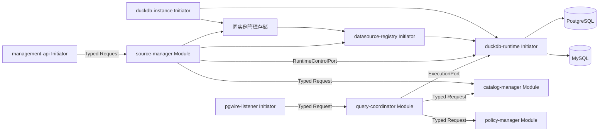

# 架构与生命周期

默认应用显式启用五个 Initiator、四个 Module；关闭管理 HTTP 时省略 `management-api`；`source-manager` 仍负责静态配置源的 DDL 后刷新。其他 crate 是领域类型或适配库。组件仅使用 Modorch Facade 0.0.1 的已核对公开 API。

`duckdb-instance` 打开唯一 DuckDB 实例，配置本地资源、初始化当前 `_fedengine` 管理表结构并执行首次导入。存储与执行均派生同一实例的连接，运行中不再次打开同一文件。单写队列只包围本地事务，远端 I/O 和排空在事务外完成；大目录首次投影和发布的事务耗时仍需关注，实测见元数据验证记录。源记录、不可变 revision、版本化绑定、完整目录快照和管理操作分别存储；当前未删除 id/别名在事务内维持唯一。

`datasource-registry` 保存已发布的有效快照、准入标记、源锁与实例屏障。`duckdb-runtime` 复用控制函数完成启动恢复，并发布执行及受控挂载端口。`source-manager` 的串行 Handler 校验并持久化意图，通过 Owner TaskScheduler 执行有界并发长任务；HTTP 请求结束不取消操作。查询工作槽与管理资源额度分开，查询满载时仍能提交停用并观察排空。

在线变更按“保存意图 → 探测 → 实例屏障及排空 → 挂载/扫描 → 保存完整结果 → 原子发布 → 操作成功”执行。配置版本推进 revision，结构/连接/范围变化推进 generation，删除重建更换 incarnation。切换失败尝试恢复旧应用版本，旧版本本已 stale 或恢复失败时保持暂停或降级。保存结果后发布/完成记录失败时继续重试本地阶段，不重做远端操作。

`query-coordinator`、策略校验及索引适配读取有效源定义，保留既有授权及能力门禁。执行先持有实例读租约，再按 DataSourceId 排序获取源锁；DDL 使用单源写锁。取得锁后复核身份、revision、generation、准入和 stale 状态，Prepared Statement 必须重新 Parse/Bind 才能使用新版本。扩展加载、临时及正式 ATTACH/DETACH、实例级缓存清理均使用实例写屏障，等待真实读租约退出。Registry 的发布锁不包围远端 I/O。

大结果经有界中性行批次通道传递，由 PGWire 编码。Worker 用 Owner 的 `spawn_blocking_io` 执行同步 I/O，ServiceLease、连接、实例/源锁和配额保留到工作实际退出。Portal 保留同一执行流，挂起 Portal 也阻止卸载；关闭、超时或取消仅发出取消请求，实际退出后才归还资源。DROP INDEX 在 DDL 锁下再次核对远端归属。

`catalog-manager` 提供已发布目录分页和真实索引归属。刷新只读取所选 schema，先清理扩展缓存，再保存完整新快照并切换指针；保留当前及有界历史快照。远端类型取自远端目录，映射类型取自锁定扩展的实际 DESCRIBE 结果，无法编码的类型和特殊索引明确标记。已确认成功的 DDL 立即推进失效状态，Worker 退出后通过 Typed Request 安排刷新；刷新失败保持远端成功事实，进入 `MetadataStale`，可在线刷新恢复。

启动从文件型管理库恢复，未结束操作标记 `Interrupted`，并生成独立恢复操作，重新核对凭据、扩展、挂载和目录。单个远端失败只影响对应源；本地管理库损坏、版本不匹配或初始化失败则启动失败。所有组件 Ready 后，两个入口才通过 `activate_ingress` 接收流量；入口 Initiator 不强依赖 Module。

退出先关闭入口、停止新意图，等待查询和管理任务真实退出，再释放存储与实例。`shutdown_checked` 返回 `StopIncomplete` 时，宿主保留句柄及资源继续等待。同步远端调用若不响应 interrupt，资源也持续保留到调用真实结束。

查询日志记录操作 UUID、SQL SHA256、Principal、Session、源集合、耗时和结果；不输出原始 ATTACH 或凭据。`FedEngine::metrics()` 提供现有 Session/Worker/等待者及执行计数；管理操作及结果通过持久化操作 API 读取。未确认的远端写入不会自动重放。管理 API 调用与部署说明见[在线管理 API](management-api.md)。

## 统一元数据与 PostgreSQL 目录

`fedengine-core::metadata` 保存关系事实、源方言表达式及分类状态。`catalog`/`relational` 采集 PG/MySQL，`identity` 在管理写事务内分配并保留 OID、attnum 和删除墓碑，`projection` 将同一快照投影为本地兼容目录；当前结构保存 revision 到身份 epoch 的持久映射、独立虚拟库及 schema 绑定，不提供历史存储迁移或旧 DTO 回退。`virtuals` 与源快照在同一本地事务内发布映射投影；映射 OID 与远端/源 database 对象身份分开，SQL 绑定和目录共用逻辑 namespace。绑定和默认 schema 修改可继承连接身份，凭据重新应用则保守创建新 epoch。

基础对象/列在扫描前后各枚举一次；发现可观察的结构漂移最多重新采集三次，再返回冲突。远端调用仍可能使用不同事务，不能宣称远端全局一致快照。分类失败保留旧事实并标记状态，完整空结果才允许淘汰。comments/view_definitions 状态来自组合 details 与列属性采集，不代表独立远端事务。

会话以 Startup database、search_path 和 namespace_version 参与规划。`fedengine-pg-compat` 根据 AST 将受支持的系统目录查询改写到按 principal/database/snapshot 限定的本地投影；内部表不可直接访问。目录结果的 PG 类型由字段与表达式来源推导，不按输出别名猜测。系统/业务混合查询及未知能力明确拒绝。

HTTP 从本地对象表按参数范围和分页读取。PG 目录 worker 持本地读事务与实例读租约，经有界批次/Portal 输出；取消、Close、断线和退出沿用受管资源规则。刷新发布与清理受实例屏障保护。无变化扫描复用 snapshot_id 并更新 freshness，不重建全部目录投影。
