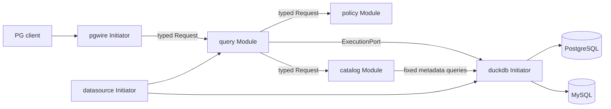

# 架构与生命周期

应用包含三个 Initiator、三个 Module，其他 crate 是普通领域或适配库。仅通过 Modorch Facade 调用实际公开 API；未修改框架 Runtime。

`datasource-registry` 发布受控源资源；`duckdb-runtime` 发布 ExecutionPort；`pgwire-listener` 保留监听器与 Session。`query-coordinator` 做 AST、绑定、授权、锁和执行编排；`catalog-manager` 负责代际快照与真实远端索引归属；`policy-manager` 默认拒绝未授权操作。Factory 注册和显式 enable 分离，Initiator 不依赖 Module。

大结果经过有界中性行批次通道传递，由 PGWire 编码，未通过 EventHub 广播。单个 Worker 克隆同一 DuckDB 实例的连接，操作后销毁；执行线程由组件 Owner 的 `spawn_blocking_io` 管理。Semaphore 限制并发与等待时限，连接操作持有 ServiceLease 和源锁到实际任务退出。

跨源读按固定 DataSourceId 顺序获取读锁；DDL 获取单源写锁。成功 DDL 更新 generation 并刷新对应扩展缓存。Prepared Statement 在执行时重新核对 generation；Portal 保持原执行流。挂起 Portal 持有源锁，关闭、超时或取消后释放；不会仅删除一个句柄就认定资源回收。DROP INDEX 在取得 DDL 锁后再次核对远端真实归属，避免等待期间对象被替换。

所有 Ready 后才通过 `activate_ingress` 接流量。启动失败保留主因和补偿结果；退出先关闭准入并取消 Session，然后检查排空与 teardown。`StopIncomplete` 会保留句柄、资源并继续等待，不会伪报正常退出。同步远端调用若不响应 interrupt，进程会继续保留资源，需由运维核对远端状态后处理。

查询/写入有 UUID OperationId、SQL SHA256、Principal、Session ID、源集合、耗时和结果日志。`FedEngine::metrics()` 提供 Session/Worker/等待者数量、准入/完成/失败/取消、未知写结果、DDL 成功、元数据过期、结果行数与累计执行时间的原子快照；计数包含 Parse 的准备执行，snapshot 不是全局事务。执行前拒绝不报告已写入；执行中的写入失败保守标记结果未知，返回 OperationId，不自动重试。确认成功但缓存刷新失败时保留成功事实，源进入 MetadataStale，拒绝后续依赖旧缓存的访问，需核对源状态并重启。日志输出应由部署环境持久化；尚未提供独立持久化审计存储或 Prometheus endpoint。
