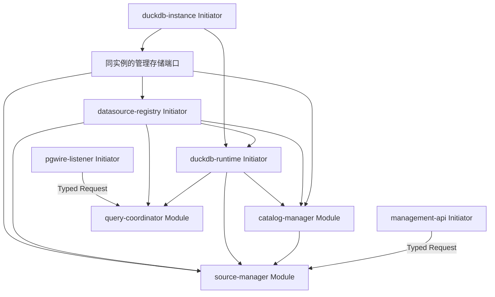

# 数据源与 Schema 在线管理收口方案

当前开发阶段没有历史数据兼容要求；仅维护当前结构，不新增历史迁移、旧格式回退或历史回填。初始化幂等、运行恢复与身份契约继续保留，见[开发规约](development.md#当前阶段的数据兼容规约)。

状态：P0–P4 已实现。本文细化[详细设计 v1.1](FedEngine_详细设计文档_v1.1.md)第 7 节，保留在线管理的行为约束；实现落点与验证覆盖见第 11 节，调用方式见[管理 API](management-api.md)。

## 1. 已确认的范围

- 支持 PostgreSQL、MySQL 数据源，以及外部 schema 的在线接入、刷新、停用和移除，无需重启 FedEngine。
- 纳入管理表示登记结构并建立联邦查询映射，不复制远端业务数据。
- 暂不建设数据权限管理，不新增角色、授权、行列权限或权限管理接口。
- 直接使用 DuckDB 持久化管理数据，不引入 SQLite 或独立数据库服务。
- 复用一个进程内 DuckDB 实例和本地数据库文件；查询与管理使用不同连接、不同执行入口。
- 第一版提供管理 HTTP API，业务 SQL 继续使用 PGWire。管理入口默认监听 loopback；本阶段不提供管理 UI。
- 保留 `catalog.schema.object` 命名，不提供任意 schema 重命名，不自动纳入新发现的 schema。
- 移除登记不执行远端 `DROP DATABASE`、`DROP SCHEMA` 或 `DROP TABLE`。

本阶段不包括数据库类型扩展、数据同步、分布式管理存储、完整 PostgreSQL 系统目录兼容、自动周期刷新和复杂凭据平台接入。手动刷新及本服务 DDL 后的失效处理必须实现。

## 2. 实施前基线与改动依据

| 位置 | 实施前行为 | 改动依据 |
| --- | --- | --- |
| `fedengine-core` | `Config.datasources` 保存静态定义 | 区分启动配置、持久化定义和有效快照 |
| `fedengine-datasource` | 不可变源映射，generation 从 1 开始 | 支持版本化发布、准入状态、持久化身份及在线变更 |
| `fedengine-duckdb/src/init.rs` | 依赖 Registry，在初始化时打开实例、加载扩展并挂载静态源 | 分离本地实例初始化与外部挂载，增加受控管理端口 |
| `fedengine-query` | Analyzer 和部分适配逻辑读取静态源定义 | 改为读取同一份有效数据源快照，并在执行准入时复核版本 |
| `fedengine-catalog` | 提供 generation 快照和远端索引归属 | 增加 schema、表、列发现和完整目录快照 |
| `fedengine-app` | 固定装配三个 Initiator、三个 Module | 装配实例资源、管理 Module 和管理入口，调整依赖关系 |
| `config/application.toml` | 已有 `[duckdb].database_path`，默认 `:memory:` | 使用本地文件；不再新增重复的 `[storage].path` |

仅修改 Registry 不能实现在线管理。绑定、状态检查、目录和运行时必须共同使用已发布版本。现有策略代码中读取静态数据源定义的位置只做动态快照适配，不扩展数据权限模型，也不借此删除已有校验。

## 3. 对象与命名

### 3.1 数据源

数据源表示一个明确的远端连接目标：

- `id`：稳定的管理标识。
- `incarnation`：本次登记的唯一身份；删除重建不得沿用旧身份。
- `kind`：`postgres` 或 `mysql`。
- `catalog_alias`：SQL 使用的 catalog 名称，在当前应用中唯一。
- `secret_ref`：完整连接串的凭据引用，保持与现有配置兼容。
- `default_schema`：默认绑定 schema，必须属于已纳入且启用的范围。
- `desired_revision`、`applied_revision`：期望版本和实际生效版本。
- `desired_enabled`：期望启停状态；实际连接状态单独表示。

第一版不支持修改 `id`、`kind` 和 `catalog_alias`；需要变更时先停用旧源，再登记新源。连接引用及 schema 范围可以在线修改。

PostgreSQL 的一个数据源对应一个 database，可纳入其中多个 schema。第一版 MySQL 的一个数据源限定为一个明确 database，不因数据库位于同一服务器就合并源身份。MySQL schema/database 的实际映射必须通过目标扩展版本的集成验证。

### 3.2 Schema 绑定

以 `(incarnation, revision, remote_schema)` 唯一标识一条版本化绑定，保存期望启停状态。schema 名称与远端一致。配置版本、目录和操作记录均引用 incarnation；源名复用不能造成历史记录混淆。

“发现结果”和“已纳入范围”分开：发现 `sales` 不会自动产生有效绑定。原有 `allowed_schemas` 在首次导入时转换为绑定记录，此后从有效绑定生成运行时列表，不维护第二份可编辑白名单。

停用当前默认 schema 前，必须同时指定有效的新默认值，或清除默认绑定；不得回退到本地 DuckDB catalog。系统和内部命名空间不作为可纳入范围。

### 3.3 元数据目录

目录至少包含 schema、表和视图、列、远端类型、映射类型、可空性、列序号及索引信息。暂不支持的类型和特殊索引应明确标记，不能伪装为已支持。

例如，数据源 `crm` 的别名为 `pg_crm`，纳入远端 `sales` 后，对应名称为：

```sql
SELECT * FROM pg_crm.sales.customers;
```

管理目录展示不等于实现 JDBC/GUI 的 `pg_catalog`、`information_schema` 浏览兼容；后者不属于本阶段。

## 4. DuckDB 持久化

### 4.1 文件与内部命名空间

复用已有配置键：

```toml
[duckdb]
database_path = "./data/fedengine.duckdb"
```

该片段只展示需要调整的字段，不是完整启动配置。相对路径继续以进程工作目录为基准。

在本地主库的保留 schema `_fedengine` 中保存管理表。普通业务 SQL 只能绑定登记的外部源，不能回退访问本地主库或内部管理表。这属于名称绑定边界，不新增数据权限体系。

所有连接由同一实例派生；不为管理操作再次独立打开同一个文件。管理写入采用单写队列和短事务，远端探测、查询排空及元数据扫描不得占用本地写事务。管理操作使用有界资源配额，避免查询占满工作槽后管理接口无法停用数据源。

启用管理能力时要求文件型数据库，遇到 `:memory:` 直接报配置错误。管理能力关闭时，允许无持久化的内存模式用于现有测试和简单开发。

### 4.2 逻辑表

| 表 | 主要内容 |
| --- | --- |
| `schema_migrations` | 当前管理结构版本及初始化时间；仅作版本标记，不执行历史迁移链 |
| `bootstrap_state` | 首次导入是否完成、输入摘要及完成时间 |
| `data_sources` | 源身份、别名、期望/生效版本、期望启停状态、删除标记 |
| `source_revisions` | 不可变的连接定义版本，包括凭据引用和默认 schema |
| `schema_bindings` | 每个配置版本选择的 schema 及启停状态 |
| `catalog_snapshots` | 源身份、配置版本、目录 generation、刷新时间、完整性与结构摘要 |
| `catalog_objects` | 快照中的 schema、表/视图、列和索引结构 |
| `management_operations` | 操作编号、幂等键、参数摘要、目标版本、阶段、结果及错误 |

目录刷新写入新快照后再切换有效指针，不在原快照上逐行覆盖。先保存完整生效版本，再按有界保留策略清理未引用的旧快照；保留当前生效版本、待处理版本和未完成操作引用的数据。

配置版本、源身份和目录 generation 分开：配置修改推进 revision；结构变化、连接切换、有效 schema 范围变化和 DDL 失效推进 generation；删除重建生成新 incarnation。预编译绑定核对身份与 generation，不能因源名复用或连接切换而访问新的连接目标。

源历史按 incarnation 保存，当前未删除记录的 id 和别名由单写事务维护唯一性；不以源名作为跨生命周期的历史主键。

### 4.3 凭据引用

不在管理表、操作参数和响应中保存明文连接密码，错误输出继续脱敏。第一版保留旧环境变量引用，并增加受控目录内的 `file:` 引用。

环境变量适用于预置凭据；运行中新增数据源使用文件引用，在配置的凭据目录写入连接串后登记即可，无需修改运行进程的环境变量。文件引用限定在该目录内，并在每次连接探测或重新挂载时重新解析。

仅修改凭据文件不会隐式切换连接，必须显式提交应用操作；这样可以观察结果并推进配置版本。

### 4.4 首次配置导入

TOML 保留应用、监听、DuckDB、超时和关闭配置。已有 `[[datasources]]` 仅作为首次导入输入：

1. 当前结构初始化完成后检查 `bootstrap_state`；未初始化时，在一个本地事务中导入源定义和 schema 绑定，并写入完成标记。
2. 空源列表同样写入初始化完成标记，避免以后因为删除了所有源而重新导入旧配置。
3. 后续启动以管理表为准，不覆盖在线修改、不复活已移除源；对非空 TOML 源列表输出清晰的“未再次导入”提示。
4. 保留独立的联邦配置示例，解释首次导入语义，不增加另一份可编辑数据源配置文件。

管理数据库、WAL、临时查询文件、下载扩展和凭据文件不提交 Git。`data/`、`secrets/` 已在现有忽略规则中；部署时本地数据库文件及其 WAL 需要放在持久化卷中。

## 5. Modorch 组件与依赖



图中指向 API/业务 Module 的消息调用与资源依赖分开处理；入口 Initiator 不声明对 Module 的强依赖，等待全局 Ready 后通过 `activate_ingress` 接收流量。

| 组件 | 职责 |
| --- | --- |
| `duckdb-instance` | 打开唯一实例、配置本地资源、初始化当前管理表，导出受控实例与存储服务 |
| `datasource-registry` | 从存储恢复定义，提供有效快照、源准入状态和版本屏障 |
| `duckdb-runtime` | 执行启动恢复，提供查询执行与受控挂载/卸载/探测端口 |
| `catalog-manager` | 发现目录、生成快照、读取管理目录；复用现有索引发现适配 |
| `source-manager` | 接受管理意图，编排持久化、探测、应用、排空及恢复 |
| `management-api` | 生命周期受管的 HTTP 入口，只做协议转换与结果映射 |

数据源记录不会变成动态 Modorch 组件。启动恢复和在线应用复用 `fedengine-duckdb` 内部的控制与恢复函数，source-manager 通过受控端口调用；下层运行时不反向依赖管理 crate，Initiator 不依赖管理 Module 才能初始化。

Handler 负责校验、登记操作及安排任务，长工作通过 Owner TaskScheduler 执行；同步 DuckDB I/O 使用 `spawn_blocking_io`。ServiceLease、源锁和执行资源保留到任务真实退出。操作状态通过 Request 读取，不把 Command Accepted 或 Request 超时当作操作完成。

本任务的主 skill 为 `modorch-module-development`，应用装配使用 `modorch-app-development`；`modorch-framework-maintenance` 仅用于确认框架边界，当前不需要修改 Runtime 或公共契约。所有 skill 继续由 skill-hub 管理。

## 6. 在线操作与一致性

### 6.1 统一操作契约

除首次登记外，所有变更携带目标 incarnation 和 `expected_revision`，也可合并为 ETag；通过比较并交换拒绝覆盖过期版本。源名复用后，旧请求同样必须冲突。同一数据源一次只允许一个改变生效状态的操作，不同源允许有界并发，实际挂载变更仍经过实例级屏障。

写接口支持幂等键。同一键和同一参数返回原操作编号；参数不同则返回冲突。返回 `202 Accepted` 前必须已经提交操作记录和对应的期望状态，不能只把工作留在内存队列中。

配置和执行状态分开返回：`desired_revision`、`applied_revision`、期望启停状态、实际状态、当前操作编号、最近错误和目录更新时间。

### 6.2 登记、测试和发现

登记只保存定义，初始状态为 `Registered`，不立即开放查询。测试连接和发现 schema 不修改纳入范围。

测试连接、发现 schema 和目录采集使用独立 DuckDB 实例，在该实例内受控挂载和清理，不加入有效 Registry，也不修改正式实例的挂载。测试另一配置版本不影响旧生效版本。

零源启动后首次接入某种数据库时，也要完成对应扩展的校验、受控加载和连接池设置，不能依赖启动时已经加载。继续遵守已有扩展安装配置，不为在线登记静默开启自动安装。

### 6.3 纳入和激活

1. 校验源身份、revision、别名和 schema 选择，持久化期望版本及操作记录。
2. 在独立实例中执行连接及兼容性探测，确认所选 schema 实际存在并采集完整目录。
3. 排空正式实例的活跃执行，在实例屏障内完成正式挂载。
4. 在屏障外的本地事务中准备身份、完整快照、目录投影、applied revision 和操作结果，保持未提交结果不可见。
5. 短屏障内复核源代际，提交本地事务并切换有效 Registry，开放该源准入；操作成功与快照指针同事务提交。

挂载不能与本地表更新组成跨系统事务。持久化完成但发布未完成时，操作保持未完成并关闭相关准入，由协调器继续发布；重启时重新核对。不得仅因为数据库表已提交就向调用方报告运行时已生效。

### 6.4 修改连接

先保存新期望版本；旧应用版本在切换开始前继续有效。切换时关闭目标源新请求、排空旧操作、卸载旧挂载，再以相同别名挂载新定义。

失败时尝试恢复上一 applied revision，保留新期望版本及失败原因。恢复成功则继续使用旧版；恢复失败则标记 `Degraded` 并关闭该源准入，不能展示为 `Active`。第一版不承诺连接切换全程无等待。

### 6.5 刷新目录

手动刷新只影响所选源已纳入的 schema，不把其他发现结果自动纳入。先在独立实例中读取完整目录，再排空正式实例并清理其扩展缓存，在屏障外准备新快照和投影，最后通过短屏障提交并切换；结构摘要变化时推进 generation 并使旧预编译绑定失效。

刷新失败保留上次目录供管理端查看，同时标记其过期。已明确知道结构变化但未完成刷新时，相关源进入 `MetadataStale`，暂停依赖旧绑定的执行；通过在线刷新恢复，不要求重启。

本服务确认 DDL 成功后，立即使相关 generation 失效并安排相同刷新流程。目录刷新失败不改变已经确认的远端 DDL 成功事实，也不能自动重放 DDL。

### 6.6 停用、移出和删除

- **停用 schema**：先禁止该绑定的新执行，排空关联操作，发布不含该绑定的有效范围；不必卸载整个源。第一版允许使用较保守的源级排空。
- **移出 schema**：完成停用后删除其当前期望绑定，保留必要的版本与操作历史。
- **停用数据源**：关闭源准入，排空后卸载，保存定义和目录供查看。
- **删除数据源**：只允许在停用且无未完成操作后执行，保存删除标记和身份历史；释放别名后重新登记必须使用新的 incarnation。

挂起 Portal 也属于活跃操作。接口等待或排空等待超时后，操作可保持 `WaitingForDrain` 并返回原因；不绕过活跃锁、不强制卸载、不把取消请求当作回滚证明。

### 6.7 查询准入与锁

Analyzer、目录解析和运行时源检查使用同一版本快照。请求即使在变更前完成分析，也必须在取得执行锁后重新检查源身份、revision、generation、启停和 stale 状态，防止等待期间状态变化。

第一版对扩展加载、`ATTACH/DETACH` 采用保守的实例级变更屏障，等待持有实例执行读租约的任务实际退出后再变更。普通目录刷新优先使用源级屏障；若扩展缓存清理影响整个实例，则升级为实例级协调。

执行与正式挂载统一按实例屏障、DataSourceId 排序的源锁获取。虚拟库变更按实例屏障、存储 writer、本地事务获取；writer 忙时立即失败，不持屏障排队。目录准备持 writer 在屏障外执行，只在准备完成后进行最多 100ms 的非排队屏障尝试；未成功先回滚、释放 writer，再等待排空并有界重试本地准备。不能持有源锁后再等待实例写屏障，也不能持有本地写事务进行无界排空等待。Registry 发布锁只用于短时间切换快照，不包围网络 I/O。详细限制和失败语义见[管理 API](management-api.md#目录刷新与资源预算)。

因此，第一版“在线”保证无需进程重启，必要时存在短暂查询准入等待；不承诺挂载期间所有源完全无感。后续只有真实引擎验证证明安全后，才缩小挂载屏障范围。

## 7. 状态与重启恢复

源实际状态：`Registered`、`Activating`、`Active`、`Draining`、`Disabled`、`MetadataStale`、`Degraded`。失败详情放入错误字段和操作记录，不用单一 enabled 布尔值代替整个生命周期。

操作状态：`Pending`、`Running`、`WaitingForDrain`、`Succeeded`、`Failed`、`Interrupted`。返回中另含具体阶段，例如 `Probing`、`Attaching`、`Refreshing`、`Publishing`。

启动顺序：

1. 校验文件路径和启动参数，打开本地 DuckDB，初始化当前结构；遇到非当前管理表版本明确拒绝启动，不自动迁移或清空。
2. 首次导入静态配置，读取持久化定义，初始化关闭准入的 Registry。
3. 对期望启用的源进行有界恢复：解析凭据、加载扩展、重新挂载和刷新目录。保存的 `Active` 状态不能直接当作连接成功。
4. 对重启前未结束的操作标记 `Interrupted`，核对期望、生效版本及真实挂载，再产生恢复操作；不盲目重放旧 SQL。
5. 原子发布恢复成功的源；恢复失败的源单独标记 `Degraded`，不阻止管理入口和其他健康源可用。
6. 所有组件 Ready 后开放管理与业务入口；本地管理库损坏、版本不匹配或初始化失败属于启动失败。

正常退出先关闭入口，停止接收新管理操作，等待管理任务和查询真实退出，再释放存储及 DuckDB 实例。超时保留未完成状态和资源，继续遵守现有 checked shutdown 语义。

## 8. 管理 API

统一前缀建议为 `/api/v1`。接口以同一 source revision 协调，HTTP 层不直接执行 DuckDB SQL。

| 方法和路径 | 行为 |
| --- | --- |
| `POST /sources` | 登记数据源 |
| `GET /sources`、`GET /sources/{id}` | 查看配置、有效版本和实际状态 |
| `PATCH /sources/{id}` | 创建连接定义的新版本，显式应用后生效 |
| `POST /sources/{id}/probe` | 测试选定配置版本 |
| `POST /sources/{id}/discover` | 发现远端 schema，不改变绑定 |
| `PUT /sources/{id}/schemas` | 提交完整的 schema 选择及启停状态，原子产生新期望版本 |
| `POST /sources/{id}/apply` | 应用指定期望版本并激活/更新 |
| `POST /sources/{id}/disable` | 保存停用意图并开始排空 |
| `POST /sources/{id}/refresh` | 刷新有效目录 |
| `GET /sources/{id}/catalog` | 按 schema、对象类型分页查看目录及过期标记 |
| `DELETE /sources/{id}` | 删除已停用的数据源登记 |
| `GET /operations/{operation_id}` | 查看操作阶段、结果或发现结果 |

变更和探测统一返回操作编号，耗时操作采用 `202`；读取采用 `200`。基础输入错误返回 `400`，对象不存在返回 `404`，revision/幂等冲突或当前状态不允许返回 `409`。操作接受后的远端失败记录在操作结果中，不能通过 HTTP 请求断开将它隐式取消或重新执行。

当前阶段只提供 API 文档及可复制的调用示例，不额外建设独立 CLI 或前端。凭据目录、监听地址、队列上限和等待时限放入新的管理启动配置；DuckDB 文件路径仍只使用原配置键。

## 9. 代码落点与实施顺序

### 9.1 目录和模块

| 位置 | 工作 |
| --- | --- |
| `fedengine-core` | 拆分启动参数与源定义；增加 revision、状态、绑定、目录 DTO |
| `fedengine-contract` | 定义中立的存储、管理、目录和运行时控制契约 |
| `fedengine-duckdb` | 新增实例资源、当前结构初始化/存储适配、连接控制及 schema/table/column 发现内部模块 |
| `fedengine-datasource` | 改造 Registry、快照发布、准入和身份/generation 校验 |
| `fedengine-catalog` | 扩展目录请求、快照存取和刷新编排 |
| 新增 `fedengine-management` crate | 容纳 source-manager Module、管理 HTTP Initiator、操作协调与恢复逻辑 |
| `fedengine-query` 及现有源定义使用方 | 移除运行路径对静态数据源列表的依赖，接入快照和屏障 |
| `fedengine-app` | 显式注册/启用新组件、启动恢复、就绪与关闭处理 |
| 配置、示例和文档 | 文件持久化、首次导入、在线管理示例和部署卷说明 |

新增 crate 对应独立管理能力；初始化、凭据解析、状态枚举等普通实现不各自拆成 crate 或 Modorch 组件。应用入口继续留在根包，不改变现有 workspace 总体结构。

### 9.2 分阶段交付

| 阶段 | 交付物 | 完成条件 |
| --- | --- | --- |
| P0：引擎验证 | 真实 PostgreSQL/MySQL 下的动态挂载、克隆连接可见性、活跃流与缓存行为验证 | 确认同实例方案成立，明确必须使用实例屏障的操作 |
| P1：持久化和启动重构 | 文件型主库、当前管理表初始化、首次导入、实例资源分离、凭据引用 | 重启恢复登记且无循环依赖，初始化不覆盖在线状态 |
| P2：在线源管理 | 操作记录、HTTP API、登记/探测/修改/应用/停用/删除、Registry 快照 | 零源启动后能接入两类数据库，变更与失败可观察 |
| P3：Schema 和目录 | 显式绑定、完整目录、手动刷新、DDL 失效、旧绑定拒绝 | schema 在线纳入/移出，结构变化后无需重启恢复 |
| P4：恢复与回归收口 | 中断恢复、超时排空、示例、部署和兼容文档 | 验收矩阵通过，检查项进入现有统一 CI |

这些阶段共同构成第一版，不能只完成登记接口就标记在线管理已交付。P0 的临时探测脚本和输出不归档；能够覆盖长期合同的用例整理为正式集成测试。

## 10. 验收矩阵

| 场景 | 必须观察到的结果 |
| --- | --- |
| 零源启动后登记 PostgreSQL/MySQL | 无需重启完成扩展加载、发现、纳入和激活 |
| PostgreSQL 只纳入部分 schema | 可发现但未纳入的 schema 不进入有效绑定 |
| MySQL namespace 映射 | catalog/schema/object 对应实际目标 database，不访问同主机其他 database |
| 查询连接在变更前后创建 | 在屏障和发布完成后观察到一致的新挂载与源版本 |
| 并发查询时修改连接 | 旧操作真实退出后切换，不在扫描或流式输出中途卸载 |
| 挂起 Portal 时停用 | 展示排空等待；关闭/完成 Portal 后继续停用，不伪报完成 |
| 过期 revision 或重复请求 | 旧版本冲突；同幂等请求返回原操作，参数不同拒绝 |
| 新连接不可达 | 操作失败可诊断；保留上一应用版本，恢复失败则降级 |
| 外部修改表结构后刷新 | 完整新快照发布；结构变化使旧 Prepared Statement 失效 |
| DDL 成功但刷新失败 | 不重放 DDL，标记 stale，可在线刷新恢复 |
| 更新 intent、挂载、提交快照或发布期间中断 | 重启能核对并恢复，不把旧 Active 或未完成操作当成功 |
| 删除后以相同 id/别名重新登记 | incarnation 不同，旧预编译句柄不能绑定新源 |
| 清空所有源后重启 | 不重新导入旧 TOML 源列表 |
| 单个远端离线 | 管理入口和其他健康源仍可用，失败源有明确状态 |
| 并发目录刷新与管理写入 | 本地事务短且可控，无锁顺序死锁，不开放半份目录 |
| 退出期间有管理任务 | 先关闭入口，任务真实退出后才释放实例和存储 |
| 访问内部管理表或任意 ATTACH | 仍被业务 SQL 绑定/执行边界拒绝 |

正式验收复用现有一次性数据库容器与统一 CI 验证任务，不增加重复构建的独立 Actions 作业。对状态转换和恢复编写必要测试，对运行时行为使用真实 DuckDB/远端集成测试，避免只测试模拟 API。

实现完成后执行适用的 fmt、严格 Clippy、单元/集成测试、Rustdoc 和真实进程 smoke，并再次核对 Modorch 指纹。测试日志、`docs/validation/`、数据库文件、临时探测结果均不纳入 Git；保留源代码、正式测试、配置示例和长期维护的文档。

## 11. 实现与验证覆盖

| 阶段 | 实现落点 | 长期维护的验证 |
| --- | --- | --- |
| P0 | 同实例连接、受控扩展加载/挂载/卸载；保守实例屏障 | `tests/engine_control.rs` 验证 PostgreSQL/MySQL 零源初始化后的动态挂载、变更前后创建的连接、活跃流释放、缓存刷新和卸载可见性 |
| P1 | `fedengine-core::management`；DuckDB `instance`、`storage`、`credentials` | core 配置测试、DuckDB 初始化/事务/凭据测试、管理持久化重启测试；覆盖空首次导入、禁止再次导入、事务回滚、非当前版本拒绝、目录逃逸和引用重新读取 |
| P2 | `fedengine-management` 的 API、Module、意图 reducer 和后台 coordinator；动态 Registry、查询和策略适配 | `tests/management.rs` 覆盖 HTTP 状态、CAS/幂等、连接探测/发现、双库零源接入、应用、失败保留旧版、排空、删除与身份重建 |
| P3 | 版本化 schema 绑定、远端结构扫描、真实映射类型、目录分页、完整快照发布、DDL 后刷新 | 真实远端集成覆盖发现不自动纳入、MySQL database 范围、Schema 纳入/移出、默认绑定清除、外部 DDL 刷新、旧 Prepared Statement 拒绝、DDL 成功但刷新失败及在线恢复 |
| P4 | 启动协调、独立恢复操作、短事务重试、目录保留、配额和 checked shutdown；配置和 API 示例 | 管理集成覆盖 `IntentCommitted`、`Attaching`、`SnapshotCommitted`、`Publishing` 持久化中断状态重启核对、单源离线、并发刷新/写入、Portal 排空、队列背压及退出时未完成意图；进程 smoke 覆盖双入口 Ready、PG 协商、HTTP 读取与 SIGTERM 排空 |

中断阶段用真实管理库中的确定性持久化状态构造，重启真实应用执行恢复；不重放历史 DDL，也不把旧 `Active` 或未完成操作改写成成功。新恢复操作具有独立编号，原操作保留 `Interrupted`。查询句柄同时核对 incarnation、revision 和 generation，源名复用不能使旧句柄绑定新登记。

管理接口、配置和持久化语义见[管理 API](management-api.md)。`scripts/test-federation.sh` 在现有一次性 PostgreSQL/MySQL 容器中依次执行引擎控制、原有联邦和在线管理集成，沿用现有统一 CI 作业。默认配置启用文件型管理库；协议及旧联邦测试显式关闭管理并保留内存模式。

验证命令为 fmt、严格 Clippy、workspace 单元/集成测试、警告视为错误的 Rustdoc、真实进程 smoke 和上述统一数据库集成脚本。真实远端验证组合为 Linux x86_64、DuckDB v2.0.0、锁定扫描扩展、PostgreSQL 17.7 和 MySQL 5.7。其他数据库类型和长时间负载验证不在本阶段覆盖范围。后续已实现的系统目录浏览、统一关系元数据和固定客户端实测见 [元数据实施方案](metadata-query-compatibility-plan.md) 与 [协议兼容说明](protocol-compatibility.md)。

Modorch 预检继续使用项目托管 skill：Facade `0.0.2`，skill revision `1.0.5`，Contract revision `1.1.0`，解析框架指纹 `e87977dbb4ac10ded6c3e5059a0dd5d547ef5e973f3f42e6a637d86647e727e1`。锁定源码与发布边界见[开发说明](development.md)。未改动框架 Runtime 或公共契约。测试日志、数据库、凭据和临时输出不纳入 Git。

## 虚拟 PostgreSQL Server 的目录边界

PGWire 接受当前用户有权连接的有效 catalog_alias 或显式配置的业务虚拟库。账号同名虚拟库通过持久化 schema 绑定组织业务源，不在登录时自动创建。零数据源时可先使用管理 API 激活源，也可连接已显式配置的空业务库。虚拟库配置、CONNECT 与源对象授权的交集、PG 登录错误行为见[账号虚拟库方案](virtual-database-pg-alignment-plan.md)。内部管理库和运行状态不作为业务数据库或 schema 暴露；状态通过管理 API 读取。标准系统 schema 保留 SQL 兼容能力，客户端默认不显示系统对象。
