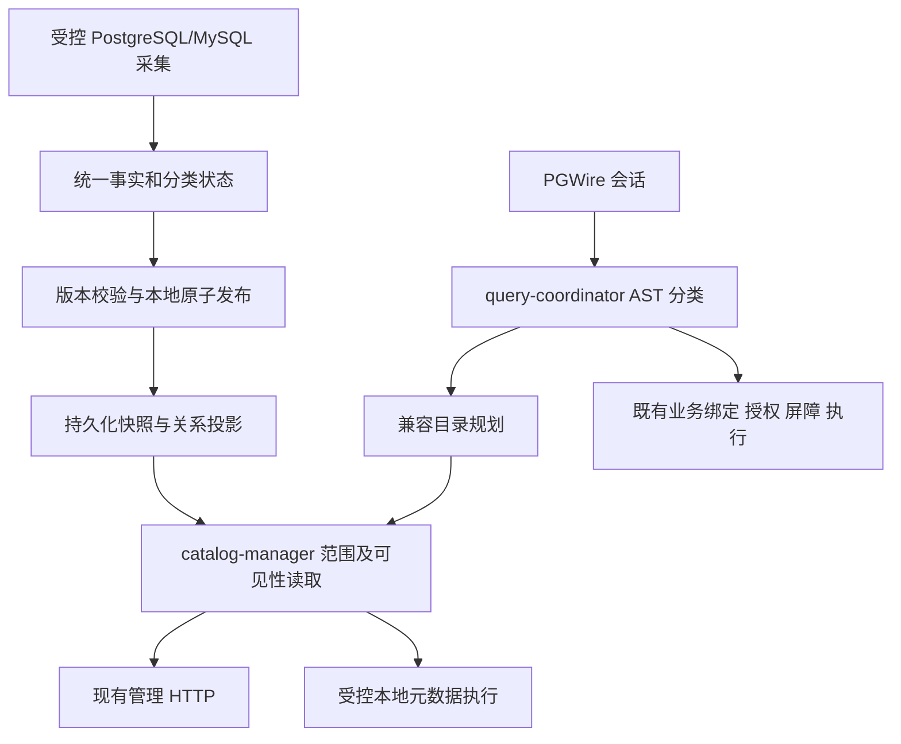

# 元数据管理与 PostgreSQL 查询兼容实施方案

状态：**用户已确认并实施**。M0–M4 的核心代码和固定客户端流程已落地；规模和故障验证仍有未完成项，边界见[开发文档](development.md#规模与故障验证边界)，后续实施见[剩余项方案](remaining-items-plan.md)。本文保留经确认的目标与验收条件，不能将目标条目直接当成已通过证据。参考工程为 `/home/fedquery/下载/federated-query-engine-9.00.00.00`。

## 1. 目标与实施前差距

目标是让 DBeaver 使用 PostgreSQL 驱动连接 FedEngine，浏览有权访问的已启用 catalog，查看 schema、表/视图、列、注释、主外键和索引，并执行现有授权范围内的业务 SQL。HTTP 和 PGWire 使用同一份已发布元数据，避免两条入口对结构给出不同答案。

实施前已经具备：源身份和版本、在线启停、完整目录快照、表列/索引发现、远端类型与实际 DuckDB 映射类型、手动及服务内 DDL 后刷新、失效与恢复控制。

实施前需要补齐以下差距；对应实现及实测状态以验证记录为准：

| 差距 | 当前落点 | 本次处理 |
| --- | --- | --- |
| 业务绑定拒绝系统命名空间 | `fedengine-ddl/src/binding.rs` | 增加受控系统目录查询路径 |
| QueryRequest 没有当前 database/search_path | `fedengine-contract/src/lib.rs`、`fedengine-pgwire/src/session/mod.rs` | 引入会话命名空间并贯通绑定 |
| 元数据只有基础列属性和索引定义 | `fedengine-core/src/management.rs` | 补齐关系元数据和分类状态 |
| 没有持久化的 PG 对象 OID、列 attnum | `fedengine-duckdb/src/storage.rs` | 增加稳定身份与迁移 |
| wire 只支持现有标量，不能表达目录 vector/array | `fedengine-contract`、`fedengine-pg-compat` | 增加目录所需类型及编码 |
| 目录 HTTP 分页读取管理状态后在内存过滤 | `fedengine-catalog/src/lib.rs` | 改为有界、按范围读取统一发布层 |
| 未验证真实 JDBC 和 DBeaver | `docs/protocol-compatibility.md` | 增加独立验收证据 |

管理 API 继续展示所有登记源及其状态。PG 目录展示当前用户可见的已启用源；尚未激活、停用、删除和恢复失败的源不伪装成可连接 database。两种展示范围不同，但结构事实来自同一发布版本。

## 2. 参考工程的采用方式

以下路径均相对于参考工程根目录。

| 参考位置 | 已观察到的实现 | FedEngine 采用方式 |
| --- | --- | --- |
| `pkg/models/relational_metadata.go` | 列属性、约束、索引键项、表达式、支持/扫描/引用/翻译状态；未知布尔值可空 | 使用 Rust 领域模型表达同样的事实边界 |
| `internal/initiators/duckdb/biz/relational_metadata_store.go` | 本地对象身份分配，事实、状态、版本与投影在同一事务发布 | 复用已有 incarnation/revision/generation，增加对象身份与原子发布 |
| `internal/initiators/duckdb/biz/relational_metadata_identity.go` | 刷新保留 relation OID 和存活列 attnum，删除列保留编号槽 | 使用本地稳定 OID、列编号及墓碑 |
| `internal/initiators/duckdb/biz/relational_metadata_publication_policy.go` | 完整枚举才允许淘汰旧事实；失败和不完整扫描保留旧结果 | 显式存储分类及子集 completeness，避免按错误码猜删除权限 |
| `internal/initiators/duckdb/biz/remote_relational_metadata.go:476` | PostgreSQL 列属性、约束、索引采集，按版本能力处理 identity/generated/INCLUDE 等 | 固定模板采集原始事实，保留顺序及来源类型 |
| `internal/initiators/duckdb/biz/remote_relational_metadata_mysql.go` | 探测 CHECK、表达式索引、生成列等目录能力，再选择采集 SQL | PostgreSQL/MySQL 分别适配，区分 MySQL 5.7 与 8.0 能力 |
| `internal/initiators/duckdb/biz/relational_metadata_list.go` | 按范围集合读取，避免逐表逐子项 N+1 | schema/catalog 读取与分页下推，避免每次读全库管理状态 |
| `assets/initia/init_tables.sql` | `pg_database/namespace/class/attribute/type/constraint/index` 等投影结构 | 建立经过客户端 SQL 验证的最小兼容矩阵 |
| `internal/modules/kernel/pgserver/biz/fed/pg_compat_rewrite.go` | PostgreSQL AST 处理兼容表达式、限定 information_schema 范围，拒绝直接访问事实存储 | 对现有 Rust sqlparser AST 做受控规划与改写 |
| 同目录 `search_path.go`、`pg_settings.go` | 会话命名空间版本、参数注册表、SHOW/current_setting 分流 | 统一 simple/extended 的会话与兼容规划 |
| 同目录 `pg_type_result_cache_test.go`、`pg_compat_rewrite_test.go` | DBeaver 类型目录、数据库/schema 查询样本及改写回归 | 作为初始查询样本，补充真实客户端采集 |
| `pkg/utils/utils.go:1259` 附近 | 为目录列修正 int2vector/oidvector 协议 OID | 采用显式结果类型和表达式类型推导，避免依赖 SQL 字符串或输出列名猜 OID |

参考工程还包含大量业务专用目录、数据库适配器和历史兼容分支。本次只引入适合现有 Rust 架构的设计，不移植其 Go 框架、UNS 规则、特殊内置库策略、内部 namespace 别名或任意系统查询旁路。

参考设计文档 `docs/relational-metadata-design.md` 的验收清单仍把 JDBC/DBeaver 列为独立工作，并记录过定义函数 alias、SHOW 参数和数据库级查询的实际问题。其局部测试及部署记录不能替代 FedEngine 的客户端验收，也不能直接推断参考工程已完成所有 GUI 功能。

## 3. database、catalog 和 schema 契约

> 本节为早期已实施契约；账号同名虚拟库、默认跨库限制及登录失败行为已由[后续确认方案](virtual-database-pg-alignment-plan.md)修订，以后者为准。原数据源 database 入口保留。

### 3.1 推荐映射

**FedEngine 对外是虚拟 PostgreSQL Server；一个有效且授权的 `catalog_alias` 对应一个 PostgreSQL database，远端 schema 保持原名。** 不创建额外入口库，不合并不同 catalog 的 schema。

```text
FedEngine 连接（PostgreSQL 驱动）
  pg_crm                  catalog_alias
    sales                 远端 schema
      customers
  mysql_erp               catalog_alias
    erp                   已限定的 MySQL database/schema
      orders
```

客户端连接时填写实际 catalog_alias；DBeaver 开启“显示所有数据库”后，通过 `pg_database` 枚举当前用户可连接的业务 database。其他 database 使用对应连接上下文浏览。

内部管理数据库与对象不向 PGWire 暴露。不存在合成的 `fedengine`、`postgres` 或模板数据库；实际登记的业务 catalog 不因同名而被认作系统库。标准 `pg_catalog`、`information_schema` 保留原名和系统查询能力，DBeaver 按其默认关闭的“显示系统对象”设置隐藏导航中的系统 schema，用户显式开启后可查看。服务端不篡改标准目录来控制客户端的导航偏好。

### 3.2 SQL 名称解析

| 连接上下文 | SQL 名称 | 解析规则 |
| --- | --- | --- |
| 任意 database | `catalog.schema.table` | 按明确 catalog 绑定，保留跨 catalog 联邦查询和既有授权 |
| catalog database | `schema.table` | 当前 catalog 内的 schema/table；不优先把 schema 猜成另一个 catalog |
| catalog database | `table` | 当前 catalog 的有效 search_path，按顺序解析 |
| 任意 database | `pg_catalog.*`、`information_schema.*` | 专用兼容目录；不绑定到远端同名 schema |

连接到 catalog database 后，默认 search_path 为该源已配置的 default_schema；没有默认绑定时为空，要求显式 schema 或 SET search_path。RESET 使用当前生效默认值。未纳入或已停用的 schema 不能参与解析；无引号标识符折叠和带引号精确匹配必须一致。

两段名称统一表示当前 catalog 内的 `schema.table`；原有依赖 `catalog.table` 简写的客户端须改用 `catalog.schema.table`。

Startup 接收明确 database；未提供或显式传空字符串时按 PostgreSQL 规则取 Startup user，但不会为该名称创建或放行数据库。不存在或当前用户不可连接的 database 返回 `3D000`；零有效源时管理 API 仍可用，PGWire 无可连接数据库。切换 database 优先使用 PostgreSQL 客户端的重新连接机制；首版不新增 `USE` 或非标准跨库 SET。保留三段业务 SQL 作为 FedEngine 的明确扩展。

### 3.3 状态与可见性

- PG 对象可见性复用既有 SELECT grants、有效 schema 绑定和源准入状态；catalog/schema 由可见对象或明确通配授权派生。只读目录不会授予业务读写权限，不新增角色或授权管理接口。
- 管理 HTTP 继续处于现有可信部署边界，可用管理身份读取全部登记状态；PG 使用会话 principal 过滤，两者复用相同事实读取服务和 scope 模型。
- `MetadataStale` 且有有效旧快照的源可浏览旧目录，业务查询继续服从既有 stale 阻断。管理 HTTP 展示快照、时间与分类状态；PG 不创建额外状态 schema，一次读取旧快照时发送有界去重 Notice，引导调用方查看管理 API，不改变标准目录列结构。
- 停用/删除完成后，新查询不再展示该源；已取得快照 lease 的有界元数据读取可完成。该 lease 不持有远端连接，快照清理由引用计数保护。
- 外键目标不可见时，不暴露目标名称/OID；API 说明引用不可见，标准目录不生成悬空可见引用。元数据定义文本同样不能泄露未授权对象。

## 4. 统一事实模型与持久化

### 4.1 事实范围

| 类别 | 必须保留的信息 |
| --- | --- |
| schema、表与视图 | 稳定身份、名称、对象类别、注释、视图原始定义及方言/翻译状态 |
| 列 | 逻辑顺序、稳定 attnum、远端类型、实际映射类型、PG 类型/OID/typmod、nullable、默认值、identity、generated、注释 |
| 约束 | PK、UNIQUE、FK、CHECK，列顺序、FK 列对、目标身份、更新/删除动作、验证/延迟/执行状态、支持索引关联 |
| 索引 | 唯一性、主键关联、方法、顺序键项、表达式、INCLUDE、排序、NULL 顺序、前缀长度、谓词、有效/可见状态 |
| 分类状态 | support、scan_state、complete_scope、stale、最近尝试/成功时间、脱敏错误、适配器能力版本 |
| 表达式 | source_text、source_dialect、可选 pg_text、translation_status |

未知或不适用的事实使用 Option，不能默认为 false/0/空定义。约束与支持索引分别建模；复合键和 FK 列对不能排序去重后改变含义。远端表达式只作为事实或经过验证的 PG 展示文本，不能直接执行。

关系元数据按 `core / column_properties / constraints / indexes / comments / view_definitions` 分类。`support` 为 supported/partial/unsupported/unknown；`scan_state` 为 not_scanned/success/partial/forbidden/failed；引用为 resolved/outside_scope/unresolved；翻译为 exact/translated/unsupported/unknown。PG 不为未知事实捏造肯定答案；必需字段无法忠实表达时保留基础表列，限制对应扩展对象投影并在状态中说明。

### 4.2 身份规则

- 在 `_fedengine` 增加持久化 OID 分配器、对象身份、列身份和分类事实/状态表，与现有管理库共用实例及迁移机制。
- PostgreSQL 标准内置类型/目录使用固定、受版本管理的 OID；本地业务对象 OID 从独立预留区分配，检查冲突与耗尽，不以哈希碰撞概率代替唯一性。
- 对象键使用结构化字段，包含 incarnation、对象类别、父对象身份及可用的远端身份；远端 OID 只作为来源信息，不能直接当作全局 OID。
- 已确认同一对象的刷新及重启保留 OID；列存活时保留 attnum，删除后保留墓碑槽，同名新列分配新编号。逻辑 ordinal 与 attnum 分开。
- 只有已经观察到删除、源内 DDL 事件或可靠远端身份变化，才认定删除重建。MySQL 等缺少可靠身份的源，离线期间同名重建不能保证识别；命名推断及其限制写入契约，不能声称任意远端重建都可追踪。
- 改名有可靠身份则保留；否则按删除/新增处理。连接目标变化不得无条件继承原目标的对象身份；为已确认的连接切换创建新的对象身份代次。单纯凭据轮换可保留，但目标无法验证一致时保守重建身份。源删除重登始终由新 incarnation 隔离。

### 4.3 采集与发布

1. 在现有受控控制端口内，用固定模板扫描已生效 schema。继续通过已锁定 DuckDB PostgreSQL/MySQL 扩展查询，不假定参考工程的自定义 Scanner ABI 存在。
2. 先探测数据库产品、版本、权限和目录字段能力，再选择 SQL。MySQL 5.7 的 CHECK 等明确标记部分支持；不因索引存在就推断所有约束事实。
3. 在本地事务之外采集和校验；记录起始 incarnation/revision/generation。远端多条目录查询默认 best-effort，通过表/列引用一致性检查及有限重试识别并发 DDL，不宣称远端全局事务快照。
4. 发布前复核源版本及 DDL fence。过时结果丢弃；不覆盖较新的目录。结构、分类事实、状态、投影和快照指针在同一本地短事务内提交，再发布有效索引。
5. 分类完整成功枚举才允许删除旧事实；合法空集合与失败、权限不足、截断和不支持严格区分。认证完整的子集只替换该子集，其他部分保留旧事实及 stale 状态。
6. core 采集失败继续沿用现有 stale/准入规则；仅注释、约束等扩展类别失败不把可查询的基础表全源阻断，而是保留该类别旧事实并降级状态。
7. 事实变化推进 metadata snapshot_version；影响业务绑定的变化继续推进 generation。仅更新时间、注释或索引展示字段不无谓使所有业务预编译语句失效；目录预编译结果类型改变时仍需重新 Parse。

HTTP 与一次 PG 元数据 SQL 均固定快照/版本向量及可见范围，不混读发布前后的表列。跨多条客户端查询不承诺全局事务快照；GUI 刷新可能观察到后续版本。分页令牌绑定快照与过滤条件，过期明确返回冲突，调用方重新分页。

## 5. PG 目录与查询执行

### 5.1 分层与路由



`fedengine-pg-compat` 增加会话探针、系统目录关系/函数描述和 AST 规划；`catalog-manager` 负责统一读取及 scope；`fedengine-duckdb` 负责内部关系投影与有界执行。入口不直接访问 DuckDB，不增加独立数据库实例，不改变 Modorch Runtime。

实现文件按现有边界组织：`fedengine-core` 保存事实 DTO；`fedengine-contract` 增加会话、目录读取和结果类型契约；`fedengine-catalog` 组织版本化读取；`fedengine-policy` 复用现有 grants 生成可见范围；`fedengine-query` 分类并调度；`fedengine-ddl` 接受显式会话绑定上下文；`fedengine-duckdb` 拆分采集、身份迁移、发布投影和目录执行；`fedengine-pgwire` 保存每连接会话并统一协议处理；`fedengine-management` 只扩展现有编排与 API。`fedengine-app` 仅调整已有组件依赖和服务装配，不为每个 catalog 创建动态组件。

查询先分类为会话控制、纯目录读取或业务 SQL。首版拒绝目录与业务对象混合查询，返回明确的 `0A000`；业务 SQL 含 current_database 等会话函数时可受控替换，仍走既有业务授权路径。

纯目录只允许只读 SELECT，以及已列出的安全函数/表达式。递归处理子查询、CTE、JOIN、别名、casts、参数和排序/过滤；预编译参数参与相同规划。保留用户输出列名，系统函数按绑定和签名识别，不依赖固定 alias，不对 SQL 文本做全局 replace。

物理执行使用同实例派生的专用本地连接：将用户系统关系绑定到带 snapshot、database、principal scope 的内部投影，不使用 DuckDB 自带全实例目录。内部物理名称仅由服务生成；用户 AST 不能直接绑定 `_fedengine` 或兼容存储，也不能通过 CTE、函数、三段名称绕过过滤。所有目录关系在 JOIN 前完成一致的可见性限定。

纯目录查询不扫描远端；读取失败不隐式触发同步刷新。执行复用现有取消、截止时间、流式批次、Portal 暂停/续读及资源释放机制。目录路径不凭此获得业务源或文件系统访问能力。

### 5.2 首批兼容矩阵

最终列、类型、函数签名和必要的辅助空目录由 M0 的实际 JDBC/DBeaver SQL 冻结。以下为必须规划的范围，不能用“创建了同名表”作为验收。

| 范围 | 目录/函数 | 行为 |
| --- | --- | --- |
| database/schema | `pg_database`、`pg_namespace` | database 列表、当前库限定、稳定 OID、授权过滤 |
| 表/列/类型 | `pg_class`、`pg_attribute`、`pg_type`、`pg_attrdef` | relkind、attnum/attisdropped、类型/typmod、默认/生成属性 |
| 注释/定义 | `pg_description`、必要的 `pg_shdescription`、`pg_views`、`pg_matviews`、`pg_rewrite` | 返回已采集事实；未支持 rule 不伪造定义 |
| 约束/索引 | `pg_constraint`、`pg_index`、`pg_indexes`、`pg_am`，必要的 `pg_opclass/pg_collation` | 有序键项、FK 引用、支持索引关联；未知项不伪造远端语义 |
| 身份/基础辅助 | `pg_roles`、客户端确实查询的 tablespace/settings 等 | 仅最小真实会话/兼容信息，不能虚构源账号或管理员权限 |
| 标准视图 | `information_schema.schemata/tables/views/columns` | 当前库、可见范围、类型/可空属性 |
| 标准约束视图 | `table_constraints/key_column_usage/referential_constraints/check_constraints/constraint_column_usage/constraint_table_usage` | 与同版本 pg_constraint 一致，FK 列序与目标唯一约束关系正确 |
| 会话函数 | `version/current_database/current_schema/current_schemas/current_user/session_user/pg_backend_pid` | 返回真实会话上下文与后端 PID |
| 展示/解析函数 | `format_type`、`pg_get_expr`、`pg_get_indexdef`、`pg_get_constraintdef`、`pg_get_viewdef`、`pg_get_ruledef`、`obj_description/col_description`、`to_regclass` 及必要 visibility/privilege 函数 | 用 OID 和作用域解析，支持实际签名及任意 alias；未知事实返回 typed NULL 或明确不支持 |

未采集的大小、统计值、分区和规则信息不返回假 0/假定义来绕过错误。若客户端要求辅助目录，可提供与明确“不支持该类对象”一致的空目录；采集失败不能伪装成空成功。客户端依赖一个尚无法忠实表达的能力时，将其列为该版本兼容缺口。

### 5.3 类型及协议

- 目录字段的 wire OID 使用专门类型描述，补充 oid(26)、name(19)、内部 char(18)、必要的 regclass/regtype/regproc、int2vector(22)、oidvector(30)、`int2[]`(1005)、`oid[]`(1028)、`text[]`(1009)。以实际矩阵裁剪或补充。
- 数组和 vector 的文本/二进制编码、NULL、边界和维度按 PostgreSQL 类型契约实现；不能把 vector 当 text、把 unsigned OID 当 int4。参数 OID、RowDescription、Describe 和 DataRow 一致。
- 表达式结果类型按 AST 和关系字段来源推导；类型 cast、alias、CTE、函数签名和 JOIN 不得使 OID 被错误推断。补充 typmod 以及可确定的 table_oid/column_attnum，无法确定时按协议规则返回 0。
- 业务列继续以真实 DuckDB 映射及 codec 能力决定 PG 类型。远端原始类型另存；无法编码的业务类型仍明确不支持，不能统一改成 text 冒充支持。目录可使用已登记的非可执行占位类型展示其来源，不能承诺该类型可查询。
- 统一会话参数注册表，Startup ParameterStatus、SHOW、current_setting 保持一致。沿用当前 PG 16 协议子集声明，不能仅为模仿参考工程改报 17.2。矩阵记录该声明触发的驱动 SQL 分支。
- 首批处理 UTF8、UTC、DateStyle、standard_conforming_strings、integer_datetimes、search_path、application_name 等驱动所需设置。驱动实际发送的 extra_float_digits 等参数在 M0 样本中逐一确认。SHOW、SET/RESET、current_setting 以及必要的 set_config 使用同一注册表，set_config 仅允许已实现的会话状态变更，不作为任意数据库配置入口。只接受与实际行为一致的值，未知/不支持值明确报错；不通过 SET 假装开启事务、非 UTC 转换或只读保证。
- 显式事务仍不在本次范围。DBeaver SQL 编辑器以 autocommit 验收；若指定版本在目录浏览时强依赖显式事务，列为阻塞缺口，不把 BEGIN/COMMIT 空操作当兼容修复。
- Session namespace_version 进入 PreparedDescriptor/绑定检查；search_path 改变后重新绑定或明确要求重新 Parse。已经打开的 Portal 固定原执行上下文，不在续读时悄悄切换。

## 6. HTTP、资源与迁移

保留现有 `/api/v1/sources/{id}/catalog`，增加 snapshot_version、分类状态和按需 include，维持已有基础字段含义。新增对象级详情以及 constraints/indexes/status 范围读取；标识符通过独立参数传递，不用点号拼接作身份。具体路由与示例在 M1 同步更新 `management-api.md`。

兼容发布层统一返回带版本的 DTO；旧数据缺少新增字段时迁移为 unknown/not_scanned，并安排显式 refresh，不能迁移时填 success。新结构使用单调 migration、事务及幂等重入检查；不重新执行 TOML 首次导入。

首版继续手动 refresh 和服务内 DDL 后刷新，不默认开启周期扫描。扩展关系元数据纳入正常刷新，按实际能力降级；不照搬参考工程“默认关闭扩展信息”的开关以致 GUI 永久缺少关系数据。

读取按 catalog/schema/object/category 下推；分页、结果批次、扫描行数/字节数、SQL 复杂度、并发和超时均有上限。不得每条目录 SQL 深拷贝全库快照。若使用缓存，键必须包含 principal、database、权限/namespace 版本与 snapshot_version，限制容量并合并相同在途请求。无变化扫描不重写全部投影；耗时、内存和锁持有时间通过基线实测确定。

身份墓碑不因快照保留数而误删；旧投影按 lease 和历史保留策略清理。分配器耗尽、迁移中断、存储损坏必须明确失败，不能重置 OID。保留当前已有单实例、管理单写、查询/控制资源隔离和受管关闭方式。

## 7. 分阶段实施与验收

| 阶段 | 开发内容 | 通过条件 |
| --- | --- | --- |
| M0 契约与客户端样本 | 固定 namespace/可见性/类型契约；锁定 DBeaver CE、PostgreSQL JDBC 制品版本与校验值；采集连接、浏览和详情 SQL | 每条样本有输入、参数、预期列/OID/结果与所属能力；不存在靠猜测的兼容声明 |
| M1 事实、身份与迁移 | 领域 DTO、分类完整性、OID/attnum、存储和统一读取；基础 HTTP 对齐 | 重启/无变化刷新身份稳定；删除重建不串身份；迁移重入与失败回滚通过 |
| M2 采集与原子发布 | PG/MySQL 关系事实、能力探测、分类降级、引用校验、过时代次丢弃 | 完整空集能删除，失败/权限不足/截断不清空；复合 FK/索引顺序正确；API 与快照一致 |
| M3 会话和基础浏览 | Startup database、search_path、参数、基础目录、类型 codec、统一 simple/extended 规划 | JDBC catalogs/schemas/tables/columns 与 PG 目录一致；两 catalog 同名 schema 不串库；Describe/Execute 一致 |
| M4 关系及定义查询 | 约束、索引、注释、定义函数、标准约束视图和 JDBC 辅助查询 | JDBC PK/FK/索引接口与事实核对，任意 alias/参数/OID 探针有效；权限过滤无泄露 |
| M5 客户端与回归收口 | 固定版本 DBeaver 真机流程、规模/并发/取消/迁移验证、更新文档及证据 | GUI 实际浏览与业务查询通过，既有在线管理/联邦/协议检查通过；未通过项保持显式缺口 |

M0 先在与协议声明一致的 PostgreSQL 16 对照库采集客户端 SQL 和正确结果，再记录 FedEngine 的失败点；不要求尚未实现目录兼容的 FedEngine 先完成浏览。后续阶段持续重放这些样本，并补充真实联邦源的预期差异。

实际数据库验证覆盖 PostgreSQL 16.11 对照库、PostgreSQL 17.7、MySQL 5.7 以及 MySQL 8.0.44。已准备隔离的 DBeaver CE 25.2.5、PostgreSQL JDBC 42.7.8 和 JDK 21，版本、制品摘要、GUI 与 SQL 回放的区分见验证记录。

必须保留以下验收场景：

1. 两个 catalog 各有同名 schema/table；业务 database 枚举、分别连接、二段/三段名称、引号和 search_path 都指向正确对象。
2. DBeaver 开启“显示所有数据库”，展开 database/schema/表/视图/列，查看主外键、索引、注释和关系图，打开数据页执行自动生成的查询；SQL 编辑器可运行授权的跨 catalog SELECT。定义页只展示有可靠翻译或明确来源说明的定义，不把远端 SQL 当可执行 PG DDL。
3. JDBC `getCatalogs/getSchemas/getTables/getColumns/getPrimaryKeys/getImportedKeys/getExportedKeys/getCrossReference/getIndexInfo/getTypeInfo`；检查列名称、顺序、类型/OID、nullable、key sequence 和 NULL。
4. simple 与 extended 的参数、Describe、文本/二进制、Portal 分批续读、取消、Sync 恢复、Close 和断线清理；实际 DBeaver 报文/SQL 可脱敏重放。
5. 远端扫描权限不足、MySQL 5.7 能力不足、失败/截断、扫描中 DDL、源停用重登、连接切换、refresh 中断，验证无错误删除、半份目录或旧代次覆盖。
6. 刷新后关系 OID/列 attnum 稳定，真实删除重建正确变化；默认值、注释、特殊索引、复合 FK、外部范围/不可见目标及未知类型都能忠实表达。
7. 不同 principal 的缓存、目录 JOIN、定义文本和 OID 探针互不泄露；直接管理表访问、混合系统/业务查询和危险函数明确拒绝。
8. 使用固定机器与规模，测量首刷/无变化刷新、目录 p50/p95、峰值内存、远端请求数、本地写锁时长及业务查询影响；首次测量建立预算，优化后按同一数据集回归，不预先宣称容量。

每阶段报告实现、自动化验证和客户端实测三种证据，保存固定客户端版本、脱敏 SQL、预期/实际结果及必要 GUI 截图。Rust workspace 检查与现有真实联邦测试继续作为回归门禁；没有实际 GUI 环境或某一步失败时，不标记 M5 完成。

## 8. 本次确认范围

用户已确认以下范围，并据此实施 M0–M5：

- 数据源 catalog_alias 对应 PG database，并支持显式账号业务虚拟库；二段名称表示当前库 schema.table，跨 database 三段扩展默认关闭，具体以后续确认方案为准。
- 以同一发布事实服务 HTTP 和 PG，补齐 PG/MySQL 关系元数据、稳定身份、分类降级及有界读取。
- 实现上表所列 DBeaver/JDBC 必需目录、函数、会话及 wire 类型，并以真实客户端验收作为完成条件。
- 不扩展其他数据库类型，不建设管理 UI/权限管理，不增加周期扫描，也不在本次实现完整 PostgreSQL、显式事务或任意系统/业务混合查询。

本次确认已经授权上述代码开发与收口；后续超出此范围的功能另行设计。
